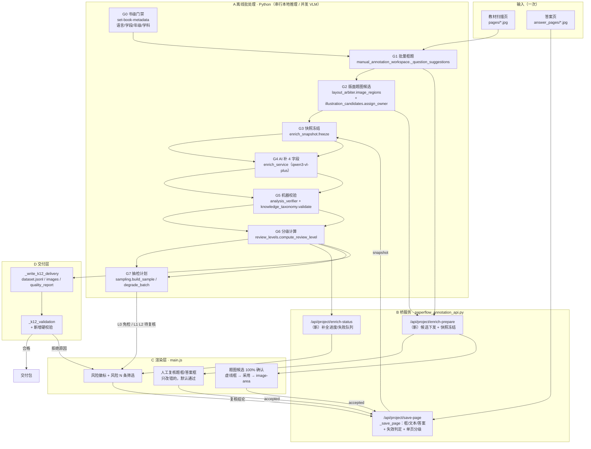
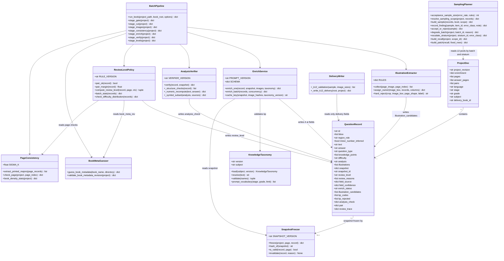
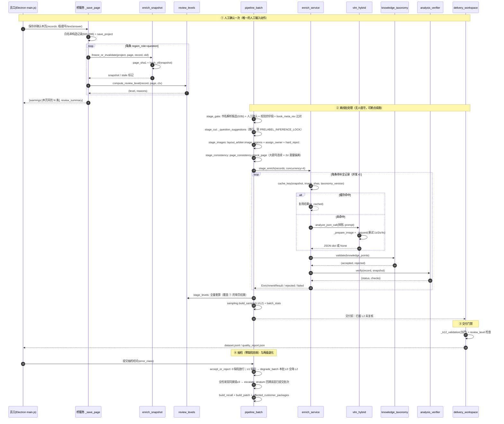
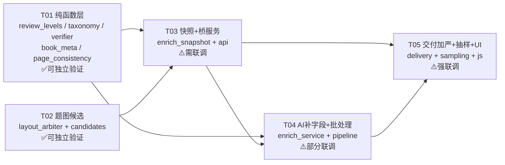

# 题库补全流水线 · 技术架构与任务分解

- 文档版本：**v1.1**（2026-10-19，已并入 PM 口径决议台账 D1–D6）
- 作者：高见远（架构师）
- 输入：产品侧已定作业流与分级复核规则（PM，`题库生产作业流与复核策略_20261019.md` v1.1 的 §2.1.1 / §2.2.1 / §7）/ 项目代码基线（本地已核实）
- 代码基线：`F:\papercutter`，`python -m unittest discover -s tests -q` 当前 456 项全通过
- 约束：不引入新的大模型依赖；复用 PP-DocLayout_plus-L 与 qwen3-vl-plus；不破坏既有测试；优先"能独立验证的最小改动"

**v1.1 相对 v1 的实质变更**（其余章节仅做一致性跟随）：

| 变更 | 章节 | 起因 |
|---|---|---|
| 配对门禁改用**原始分合取**，`score/300` 降级为纯展示量 | §0 F1、§2.4 #13、§8.2 | D1：`/300` 在 500–650 区间截断，**margin 信息被夹平**，而 margin≥80 是防"不同单元重复题号"的唯一信号 |
| 撤回"`score≥0.85` 免检"，L0/L1 分野改为 `margin ≥ 120` / `[80,120)` | §8.2 | D1（PM 主动撤回无依据阈值） |
| 抽样改为**零缺陷验收**，补 29 档与"能说/不能说"表述 | §8.4 | D2 |
| 引入**批 / 抽检层 / 包**三级粒度，`batch_id` 增 `run_seq` | §2.2、§8.4 | D3 |
| 难度加 `difficulty_scheme` + 包内值域一致性 + 分布坍缩告警 | §2.2、§5.2、§8.6 | D4 |
| 回溯三件产物（召回清单/补丁包/影响面台账）落地为数据结构 | §8.4 | D5 |
| 书级字段进快照并计 `book_meta_rev`，变更即全书 stale + 加锁 | §3.1、§3.5 | D6 |
| 新增**书名解析器**与**页级题量一致性漏题检测** | §1.4、§8.7 | D6 + PM 指出的"漏题无错误信号" |
| 复算校验接口定 P0、交付拦截定可开关 | §7.5 | PM 提问 2 |

---

## 0. 先对齐 5 处口径（代码事实 vs 任务书描述）

这一节很重要：下面 5 条会直接改变实现方式，先钉死再往下设计。

| # | 任务书描述 | 代码事实 | 本设计的处理 |
|---|---|---|---|
| F1 | 配对 `score<0.6` 作为 L2 信号 | `review_tools/manual_annotation_data.py:1159-1220` 的 `candidates()` 返回的是**累加制原始分**，不是 0~1 概率；按加分项复算上限：`180(大+小问) + 90(subsection) + 45×depth(路径逐层) + 140(路径全等) + ≤60(context)`，depth=3 时 **545**，depth=4 时约 590–605。现有自动通过线是 `desktop_annotation/paperflow_annotation_api.py:1016-1022` 的**三条件合取**：`number_path_matches AND best_score ≥ 180 AND (best-second) ≥ 80` | **按 D1 执行**：门禁一律用原始分合取，`score/300` 只做 UI 展示。理由见 §0.1-D1：545/300≈1.8，clamp 到 1.0 之后两条"完美匹配"样本的 margin 全部变成 0，`margin ≥ 80/120` 这条唯一的防重复题号信号被彻底夹平。字段拆成 `pair{score,margin,path_match,ok,display_confidence}`（§2.4 #13） |
| F2 | AI 通道"已有重试/失败降级" | `vlm_hybrid.py:239-251` 的 `_request()` 是**单次 urllib 调用，无重试**；`analyze_page()` 等函数 `except → return None`（`:431-432`）只有 fail-open 降级 | 重试需要新增。在 T04 给 `vlm_hybrid.py` 加一个**新公开函数**（不动既有函数签名），内部做 3 次指数退避；既有 9 项 `test_vlm_hybrid.py` 不受影响 |
| F3 | `layout_arbiter.detect()` 缓存只有 summary | 确认：`layout_arbiter.py:356-364` 的 payload 里 `'regions': len(regions)` 是**计数 int**（命名容易被误读成列表），`'body_regions'` 同理；带 label 的框一个都没落盘 | 只在 `detect()` 增**新键** `regions_detail`，不动 `regions` / `body_regions` 语义（避免 `_same_layout` 及测试被波及）。并且 detail 默认不写，只在显式请求时写，避免全量重算风暴（见 R1） |
| F4 | 21 题全拒绝的原因归到"字段缺失" | 其中 语言/学段/年级/学科 来自 **project 顶层**（`delivery_workspace.py:307-310` 读 `project.get("language")`），由 `paperflow_annotation_api.py:1326-1359` 的 `_set_book_metadata` 写入，且强制四项非空 | 流水线**第一步必须是书级门禁**。但按 D6 修正措辞：**不是"AI 补不了"，而是"逐题 VLM 调用补不了"**——这四项是全书 350 题共用的一个值，从书名可高置信解析，人工确认一次/书即可（§1.4 G0b 书名解析器）。见 §1.4 |
| F5 | 题图人工 5 s/题的假设 | 代码里**没有任何"与整页相似度"实现**：`layout_arbiter._image_key()`（`:137-147`）是内容指纹（判同一页），不是相似度；`_k12_validation`（`delivery_workspace.py:200-221`）只查"非空 + 最短边≥128" | 相似度硬拒是本设计**新增**，见 §4.4 的 `page_like`（感知哈希，20 行，零新依赖）。**T02 未上线前，题图确实是纯人工 100%**，5 s/题的假设不成立；T02 上线后按 §4.4 回落到机检前置 + 人工确认 |

另有两处次要事实需要记录，避免后续踩坑：

- **F6 选项图通道实际不可达**：`main.js:2088-2089` 把 `image_kind` 写死 `'question_image'`、`option_label` 写死 `''`，所以 `delivery_workspace.py:288-292` 的 `option_images` 分支永远不会命中；`main.js:2129` 又把 `options` 写死 `[]`，选项只能靠 `_split_ocr_choices(question.text)` 反推。本轮不改（会动交付契约），但题图候选设计要给 `option_label` 留出写入口。
- **F7 `question_type` 默认"填空题"有 5 处**：`annotation-manager.js:1078`、`main.js:2027/4063/4069`、`ui-manager.js:987`（下拉默认选中）。所以"缺少题型"这条校验永远不触发。修法不是简单删默认值（`test_ocr_delivery_export.py:24` 与交付映射都依赖它），而是见 §2.5。

### 0.1 口径决议台账落点（对齐 PM 文档 §7 的 D1–D6）

| 决议 | PM 结论 | 本设计的落点 | 与 v1 的差异 |
|---|---|---|---|
| **D1** | 配对用原始分合取；`0.6` 仅在 `path_match=True` 前提下等价；撤回 0.85 免检 | §0 F1、§2.4 #13（`pair` 字典）、§8.2（`pair_fail` / `pair_margin_low`）、§8.4（L0 需 `margin≥120`） | **推翻 v1 的 `/300` 门禁**。v1 的 `pair_confidence` 只保留为 `pair.display_confidence`（UI 看板用），**任何判定不得读它** |
| **D2** | 零缺陷验收，`n=ln(0.05)/ln(1-e)`，0 缺陷才放行；对外只能说"95% 置信上界 ≤x%" | §8.4（`sampling_rules.json` 带 `type/defects_allowed/upper_bound/statement`；29 档补入；抽检池只取 L0） | v1 的"可配置 59/19 映射"升级为**带语义的零缺陷验收**，且补了 29 档与表述红线 |
| **D3** | 批=一本书一次批处理，`batch_id` 带 `run_seq`；抽检层=同系列+同版式+相邻出版批；单本 <59 题跨书累积 | §2.2（`batch_id`/`run_seq`/`stratum_id`）、§8.4（`resolve_sampling_scope()`）、§4 抽检面板 | 新增 `stratum` 这一层，v1 只有"批" |
| **D4** | 难度 1–5 整数 + `difficulty_scheme` + 包内禁混值域 + 分布坍缩告警 | §2.2（`difficulty_scheme`）、§5.2（prompt 带 scheme）、§8.6（`check_difficulty_distribution()`）、§9 T05 | v1 只有"1~5"这个值域，缺 scheme/一致性/坍缩三层保护 |
| **D5** | 绝不动历史包；召回清单 + 补丁包（delete+insert，带 `supersedes`）+ 影响面台账 | §8.4（三个产物的数据结构与生成函数） | v1 只有"出召回清单"，缺补丁包与台账 |
| **D6** | 书级门禁 P0-0；加 P0-0b 书名解析器；`book_meta_rev` 进快照，变更即全书 stale | §1.4（G0b）、§3.1（`book_meta_rev`）、§3.5 第 5 条（全书失效 + 加锁）、§9 T01/T04 | v1 只做了门禁，**漏了"书级字段变更导致静默不一致"**这个失效模式 |

未覆盖项：PM 未对 v1 §11 的 **U7（"新书前 20 页"是否每本都算）** 表态，仍按"每本前 20 页"实现，并在 `batch_stats` 里把该规则单独计数，便于超标时改口径（见 §11）。

---

## 1. 总体架构

### 1.1 分层与运行位置

设计原则：**人只对"输入"负责一次，机器负责其余**。因此把系统切成四层，层间用"快照"这一唯一契约解耦。

| 层 | 载体 | 进程/时机 | 职责 | 关键约束 |
|---|---|---|---|---|
| A 离线批处理 | Python CLI / 新模块 `review_tools/pipeline_batch.py` | 后台批量、无人值守、可断点续跑 | 批量框题、版面题图候选、快照冻结、AI 补字段、解析机检、分级计算、抽检任务生成、交付前门禁 | **不能**占用 Electron 进程；本地 OCR/版面推理必须串行（`PRELABEL_INFERENCE_LOCK` 同源约束），只有 VLM 网络调用可并发 |
| B 桥服务 | `desktop_annotation/paperflow_annotation_api.py`（本地 HTTP，端口由 Electron 拉起） | 员工操作时实时 | 唯一 UI 后端。单页粒度：保存页/确认页/整页 OCR/匹配/交付同步 | `_save_page` 的显式字段白名单是唯一记录入口（`:665-696`），后端**不能**信任 UI 传来的 enrich 字段，必须后端算 |
| C Electron 渲染层 | `desktop_annotation/PaperFlow-Annotation/resources/app/js/*.js` | 员工操作时 | 只做交互与呈现：题图候选虚线框 + "采用"、风险徽标、"风险 N 条"筛选、抽检面板 | **不做**任何判定逻辑；改动极易撞 `tests/test_employee_workbench_ui.py`（91 项字符串契约断言，用 `source.index()` 切方法体）→ 见 R5 |
| D 交付层 | `review_tools/delivery_workspace.py` | 导出/同步时 | `k12_dataset/dataset.jsonl` + `images/` + `pages/P*/` + `quality_report.json` | `_k12_validation()` 是最后一道闸；新校验必须**只加严不放松**，且能按开关回退 |

为什么分级复核 **不放 UI**：`review_level` 需要跨页/跨批信号（配对、续页、整本前 20 页、批内退化）。渲染层只有当前页上下文，放这里必然算错，而且改 UI 就要改 91 项契约测试。所有判定集中在 A/B 两层的纯函数里。

### 1.2 数据流总图



### 1.3 快照是唯一契约（这是整个设计的地基)

一句话：**人确认一次 → 冻结成不可变快照 → 之后所有 AI 字段都基于快照生成 → 人不再逐题看输入。**

因此：快照变则 AI 字段全部作废（回 L2）；快照不变则 AI 结果按内容哈希命中缓存，零成本重跑。这条不变式让"人工工作量"与"AI 调用量"都变成可预测的常量。

### 1.4 五道门禁（Gate）

流水线不是一条直线，而是五道闸。每道闸都能独立跑、独立验收：

| 门禁 | 位置 | 不通过后果 | 为什么必须先做 |
|---|---|---|---|
| **G0 书级门禁** | 批量前，调 `/api/project/set-book-metadata` | 该本不进流水线 | 真实交付包 21 题全拒的首要原因是 `language/stage/grade/subject` 为空（`delivery_workspace.py:307-310` 读 project 顶层）。**逐题 VLM 补不了**这 4 个字段——它们是全书共用的一个值，错一个污染 350 题（D6） |
| **G0b 书名解析器** | 同 G0，先出候选再人工确认 | 解析置信度低 → 强制人工填 | 178/182 本书名含学科与年级，`学科/学段/年级/学期` 可从书名高置信解析；人工只需确认一次/书（≈30 s，摊到 350 题 ≈0.1 s/题）。纯人工录入是浪费，纯自动又不敢（书级值一错污染全书） |
| **G0.5 题框门禁** | 页面 `status=accepted` 且 `region_role=question` 的记录数 >0 | 该页跳过 | `_page_ocr` 与 `_write_k12_delivery` 都要求页面 accepted（`paperflow_annotation_api.py:1586`、`delivery_workspace.py:333`） |
| **G4.5 字段门禁** | 词表校验 + 解析机检 + 题图硬拒 | `enrich_status=rejected/failed` → 人工队列 | 保证"越界不入库"，把 AI 幻觉挡在交付之前 |
| **G8 交付门禁** | `_k12_validation` 加严 + `review_level=L2` 未复核拦截 + 难度值域一致性 + 漏题告警 | 不进 `dataset.jsonl`，原因进 `quality_report.json` | 现有校验只查"题图非空 + 最短边≥128"，判不出整页截图/公式截图/序号图，也判不出**漏题**（少题不报错） |

**G0b 的接口设计**（新增 `review_tools/book_meta.py`，纯函数，T01）：

```python
def guess_book_metadata(book_name: str, directory: str = '') -> dict:
    """从书名/目录名解析书级字段候选。返回
    {'subject': {'value':'数学','confidence':0.95,'evidence':'书名含「数学」'},
     'stage': {...}, 'grade': {...}, 'term': {...}, 'warnings': [...]}
    低置信字段 value 为空、confidence < 0.6，由 UI 强制人工填。"""

def validate_book_metadata_revision(project: dict) -> dict:
    """计算 book_meta_rev = sha256(language|stage|grade|subject|difficulty_scheme)。
    与 project['book_meta_rev'] 比较，不一致 → 全书 stale（§3.5 第 5 条）。"""
```

- 解析依据：书名正则（`一年级|1年级|七年级上|必修一|上册`）、目录名、`major_title` 里出现的高频章节词（辅助，不单独定值）。
- **不允许**解析结果直接写库：必须是"候选 + 人工点确认"，因为书级错误的下游代价是 350 题。
- 解析失败（如"专项训练"无年级）→ `grade` 留空 + `warnings`，人工填。宁可卡住一本，不放过静默错值。

---

## 2. 数据模型增量

### 2.1 设计约束（来自代码）

1. `manual_annotation_data.normalize_record()`（`:209-251`）**只增不删**未知字段，所以新增字段会被 `save_project` 原样持久化 —— 不需要改 schema。
2. 但 `_save_page`（`:665-696`）用**显式白名单**构造记录，UI 传来的未知字段会被丢弃。所以：**enrich 字段一律由后端在 `_save_page` 之后写入**，不经过 UI 白名单。
3. `merge_persistent_delivery_state()`（`:526-591`）在"渲染层整工程 autosave"时只保留 `delivery_id`（记录级）与 `rotation/rotated_image`（页级）。**这是最大隐患**：如果 enrich 字段不加入保留名单，一个开着旧版的员工点保存，就会把整本的 AI 补全结果抹掉（见 R2）。
4. `workspace_store.py:38-49` 的 `region` 表有 `payload_json`（整条记录 JSON）。所以 `review_level` 等新字段**落地到工作台 SQLite 无需迁移**，只是 `page_snapshot()`（`:112-135`）的 `SELECT` 列清单要补（否则 UI 读不到）。

### 2.2 project 级新增

| 字段 | 类型 | 默认 | 写入方 | 读取方 |
|---|---|---|---|---|
| `enrichment` | `dict` | `{}` | A 批处理 / B 桥服务 | 交付层、抽检面板 |
| `enrichment.schema_version` | `int` | `1` | A | A |
| `enrichment.prompt_version` | `str` | `''` | A | 缓存 key、快照失效判定 |
| `enrichment.taxonomy_version` | `str` | `''` | A | `knowledge_taxonomy` |
| `enrichment.model` | `str` | `'qwen3-vl-plus'` | A | 缓存 key、成本统计 |
| `enrichment.batch_id` | `str` | `''` | A | 抽检、退化回溯。格式 `<book_id>-<yyyymmdd>-<run_seq>`（D3：`run_seq` 必填，区分返工轮次） |
| `enrichment.run_seq` | `int` | `0` | A | 同上，本轮次序号 |
| `enrichment.stratum_id` | `str` | `''` | A / 人工指定 | **抽检统计作用域**（同系列+同版式+相邻出版批）；单本 L0 池 <59 时跨书累积用（D3） |
| `enrichment.degraded` | `dict` | `{}` | A（`sampling.degrade_batch` / `escalate_stratum`） | UI 提示、召回清单。键为 `batch_id` 或 `stratum_id`，值含 `{'level':'batch'|'stratum','reason':...,'at':...}` |
| `enrichment.level_stats` | `dict` | `{}` | A（`review_levels.batch_stats`） | 目标占比监控（L2≤15%，L0 60~75%） |
| `difficulty_scheme` | `str` | `'1-5'` | A / B（`_set_book_metadata`） | 交付门禁（包内值域一致性）、难度分布监控（D4） |
| `book_meta_rev` | `str` | `''` | B（`_set_book_metadata` 成功后重算） | 快照失效判定（D6，§3.5 第 5 条）。`sha256(language|stage|grade|subject|difficulty_scheme)` |
| `book_meta_locked` | `bool` | `False` | B（书级字段首次确认后置真） | 防止"改了学科但交付包还是旧值"的静默不一致；改需显式解锁并接受全书 stale 的代价（D6） |

### 2.3 page 级新增

| 字段 | 类型 | 默认 | 写入方 | 读取方 | 说明 |
|---|---|---|---|---|---|
| `layout_revision` | `str` | `''` | A | A | 该页版面缓存 revision，用于判断题图候选是否过期 |
| `illustration_ready` | `bool` | `False` | A | B 下发候选、UI | 候选是否已生成；未生成时"题图无候选"信号不可信（见 R3a） |
| `review_summary` | `dict` | `{}` | B | UI 页级徽标 | `{L0:n, L1:n, L2:n}`，避免 UI 遍历 |
| `page_consistency` | `dict` | `{}` | A（`page_consistency.check_page`） | 分级规则、`quality_report.suspected_missing` | `{ok, checks:[{name,ok,detail}]}`；漏题是唯一没有错误信号的失效（§8.7） |
| `question_density` | `int` | `0` | A | 同上 | 该页 `region_role=='question'` 计数，供 2σ 偏离计算 |

### 2.4 record 级新增（question 记录）

全部由后端写、UI 只读。**用于交付的字段一个都不新增**，新字段只做"决策与审计"，交付契约保持 `delivery_workspace.py:304-331` 原样（除了 §8.4 的 `quality_report` 增强）。

| # | 字段 | 类型 | 默认 | 写入方（唯一） | 读取方 | 说明 |
|---|---|---|---|---|---|---|
| 1 | `snapshot` | `dict \| None` | `None` | B（`_save_page` accepted 时）/ A | G4 补全、G5 机检、失效判定 | 见 §3 |
| 2 | `snapshot_id` | `str` | `''` | 同上 | 缓存 key、审计 | `snapshot['hash'][:16]` |
| 3 | `review_level` | `str` | `'L2'` | A / B（单页即时） | 交付门禁、UI 徽标、抽检 | 值域 `L0/L1/L2`。**默认 L2**：没算过就按需人看，符合"宁可多看一条，不可漏放" |
| 4 | `review_reasons` | `list[str]` | `[]` | 同上 | UI 展示"为什么是风险"、抽检分层 | 规则码见 §8.2 |
| 5 | `field_source` | `dict[str,str]` | `{}` | A（G4）/ B（人工改字段时置 `human`） | 交付门禁、审计 | 键：`question_type/knowledge_points/difficulty/analysis/text/answer/illustrations`；值域 `ai/ai_cached/rule/human/empty/stale` |
| 6 | `field_confidence` | `dict[str,float]` | `{}` | A（G4） | 抽样分层、难度分布监控 | 0~1，同名键 |
| 7 | `enrich_status` | `str` | `'none'` | A（G4/G5） | 人工队列查询、UI | `none/pending/running/done/failed/stale/rejected` |
| 8 | `enrich_error` | `str` | `''` | A | 运维排查 | 最近一次失败原因（截断 300 字） |
| 9 | `illustration_candidates` | `list[dict]` | `[]` | A（G2） | UI 候选虚线框、交付门禁 | 元素结构见 §4.3 |
| 10 | `kp_codes` | `list[str]` | `[]` | A（G5） | 交付、词表运营 | 词表码，与 `knowledge_points` **同序**一一对应 |
| 11 | `kp_rejected` | `list[str]` | `[]` | A（G5） | 词表运营面板 | 越界词原文，非空即 `enrich_status='rejected'` |
| 12 | `analysis_check` | `dict` | `{}` | A（G5） | 交付门禁、抽检 | `{status: pass/fail/not_checkable, checks:[...], verifier_version}` |
| 13 | `pair`（字典） | `{score:float, margin:float, path_match:bool, ok:bool, display_confidence:float}` | `{}` | B（`_set_pair` / 批量匹配后） | L2 判定读 `ok/margin`；`display_confidence` 只供匹配面板排序与可视化 | 判定一律用原始分合取（`path_match && score>=180 && margin>=80`）；`display_confidence=clamp(score/300,0,1)` **不参与任何判定**，见 D1 |
| 14 | `review_trace` | `dict` | `{}` | A / B | 审计、退化回溯 | `{computed_at, rule_version, human_level, sampled_by, sampled_at, batch_id}` |

### 2.5 「默认填空题」的处理（F6）

不删默认值（会破 `K12_QUESTION_TYPES` 映射与既有测试），改为**分层表达"已知 vs 未填"**：

1. `annotation-manager.js:1078` / `main.js:2027/4063/4069` 的默认值保留，但**同时**写 `field_source['question_type'] = 'empty'`（若来自默认值而非人工选择）。
2. 判定"人工是否真的选过"：UI 下拉一旦被 `change` 事件改动，就写 `field_source['question_type']='human'`。这是渲染层唯一的判定逻辑，且是"记录来源"而非"业务判定"，可接受。
3. `_k12_validation` 新增：`field_source.get('question_type') == 'empty'` → `errors.append('题型未确认')`。这样"缺少题型"这条校验**第一次真正生效**，而且不用改任何默认值。

### 2.6 类图


---

## 3. 快照机制

### 3.1 冻结什么

冻结"人工承诺过的输入"，且**只冻结输入，不冻结输出**：

```json
{
  "hash": "9f2a...c1",
  "version": "snapshot-v1",
  "created_at": "2026-10-19T14:32:10",
  "kind": "question",
  "page_index": 12,
  "bbox": [110, 240, 980, 690],
  "page_sha1": "7b3e...",
  "text": "3. 计算 12×4+8=____",
  "text_conf": 0.93,
  "text_engine": "paddleocr_local",
  "options": [],
  "answer": "56",
  "answer_ids": ["a-3f19..."],
  "answer_source": "paired",
  "shared_context_bbox": [],
  "shared_context_segments": [],
  "continuations": [{"page_index": 13, "bbox": [110, 120, 980, 400]}],
  "illustration_boxes": [[420, 380, 760, 660]],
  "profile": "exam",
  "taxonomy_version": "math-2026.10",
  "prompt_version": "enrich-v1",
  "difficulty_scheme": "1-5",
  "book_meta_rev": "c41d...9a",
  "batch_id": "B0001-20261019-3"
}
```

`book_meta_rev` 与 `difficulty_scheme` 进快照是 D6 的直接要求：书级字段是**全书 350 题共用的一个值**，它变了而快照没变，就会出现"改了学科但交付包还是旧学科"的静默不一致——这种错比字段缺失更难查，因为校验全过。`batch_id` 进快照是为了回溯时能定位"这条结论是哪一轮算的"（D3 的 `run_seq`）。

字段取值来源（每一条都能对应到真实函数）：

| 快照字段 | 来源 |
|---|---|
| `bbox` | `record['bbox']` |
| `text` | `record['text']`（整页确认后由 `_page_ocr` 写入，`paperflow_annotation_api.py:1635-1637`，`engine=paddleocr_local`） |
| `answer` | 配对答案记录的 `record['answer']`；多段答案按 `delivery_workspace.answer_chain()` 的顺序拼接（续页 `region_role=continuation` 沿 `continuation_of` 链） |
| `continuations` | `all_questions()` 里 `region_role=='continuation' and continuation_of==record.id` 的记录 |
| `shared_context_*` | `record['shared_context_bbox']` / `record['shared_context_segments']`（`normalize_record` 已归一，`:188-206`） |
| `illustration_boxes` | `record['illustrations']` 里人确认过的框（**不含** `illustration_candidates`） |

### 3.2 存哪里

**权威副本：record 内嵌 `record['snapshot']`。** 理由：

1. `save_project()`（`manual_annotation_data.py:642`）是整工程 JSON 原子写，内嵌即随工程一起原子落盘，不需要第二套事务。
2. 会经 `sync_project()` 进 `workspace_store` 的 `payload_json`（`:99`），工作台无需额外查询。
3. 会经 `build_project_sync_snapshot()`（`online_review_sync.py:149`）同步到公司员工目录，天然可审计。

**非权威副本（审计/回溯用，丢了不影响）**：`runtime/enrich/snapshots_index.jsonl`，每行 `{book_id, question_id, snapshot_id, page_index, created_at, taxonomy_version}`。**只追加不读回**，用于"某版本的快照被谁算过"的追溯。

**不进快照的东西**：AI 输出。理由：AI 输出是可重算的派生数据，进了快照就会和"人确认的输入"混为一谈，无法判断"这条解析是哪个版本的 prompt 生成的"。AI 侧单独记 `field_source` + `field_confidence` + `enrichment.prompt_version`。

### 3.3 内容哈希

```python
# review_tools/enrich_snapshot.py
def hash_of(snapshot: dict) -> str:
    payload = {k: v for k, v in snapshot.items() if k not in ('hash', 'created_at')}
    return hashlib.sha256(_canonical_json(payload)).hexdigest()
```

`_canonical_json` 直接复用 `review_tools/online_review_sync.py:27-28` 的范式（`sort_keys=True, separators=(",", ":")`），保证跨进程稳定。**不要**用 `hash(json.dumps(...))`（Python 内建 hash 每进程加盐，缓存会全废）。

`page_sha1` 复用 `layout_arbiter._image_key()`（`:137-147`）的思路：缩放到 160px 宽 + 拼上 `img.shape`，再 sha1。这样换源图（重扫/重新旋转）能检出，而 JPEG 重压的微小差异不会误判失效。

### 3.4 冻结时机（唯一入口）

只有一处：`paperflow_annotation_api._save_page()` 末尾，条件 `payload['accepted'] == True and kind == 'question'`（对应 `:759` 写 `status='accepted'` 处之后）。

```
_save_page 内新增（在 annotation_data.save_project 之前）:
  for record in cleaned:
      if record['region_role'] != 'question': continue
      old = existing_records.get(record['id'], {})
      enrich_snapshot.freeze_or_invalidate(project, pages[page_index], record, old)
```

**答案后到的处理**（关键细节）：员工通常先确认题页、后确认答案页。所以答案页确认时（`kind=='answer' and accepted`）必须**回写**所有引用这些答案的 question 快照的 `answer` / `answer_ids` 段并重算 hash —— 否则快照会永久缺答案，AI 解析必然瞎猜。实现：`enrich_snapshot.refresh_answer_segment(project, answer_ids)`，遍历 `project['pairs']` 反查。

### 3.5 失效条件（5 条，判定顺序即优先级）

| # | 条件 | 判定 | `enrich_status` | `review_level` | AI 字段处置 |
|---|---|---|---|---|---|
| 1 | `bbox` 变化（人改了框） | `record['bbox'] != old['bbox']` | `stale` | 强制 **L2** | 保留但标 `field_source='stale'`，不进交付 |
| 2 | `text` / `answer` / `options` 变化（人改了文本或答案） | 逐字段比较 | `stale` | 强制 **L2** | 同上 |
| 3 | `page_sha1` 变化（换源图 / 旋转） | 重算指纹比较 | `stale` | 强制 **L2** | 同上 |
| 4 | `taxonomy_version` / `prompt_version` 升级 | 版本串比较 | `kp_stale` / `analysis_stale` | **不降级**（人没改输入） | 只重算受影响字段（省 90% 成本） |
| 5 | **`book_meta_rev` 变化（改了书级四字段或 difficulty_scheme）** | `sha256(...)` 比较 | 全书 `stale` | 全书强制 **L2**？**否——只重算不改级别** | 只重算受影响的 AI 字段（学科/学段变化会影响题型/难度/知识点判断，解析不受影响）；**交付时必须整本重导**，否则新旧混排 |

**第 5 条（D6）的具体约束**：

- `book_meta_rev` 由 `_set_book_metadata` 在写入 `language/stage/grade/subject/difficulty_scheme` 后重算并落 `project['book_meta_rev']`。
- 变更检测：`pipeline_batch.stage_gate()` 开头比较 `project['book_meta_rev']` 与"按当前字段重算的值"，不一致 → 标 `enrichment.book_meta_dirty = True` → 整本所有记录 `enrich_status='stale'` + `enrich_cache` 全部 miss（因为 cache_key 里带 `book_meta_rev`）。
- **不降 `review_level`**：人没改输入，让他重看 350 题的框是纯粹浪费。但**交付门禁必须拦**：存在 `book_meta_dirty` 时不出包，直到整本重跑完。
- **加锁**：书级字段首次确认后 `book_meta_locked=True`；再改需要显式解锁，UI 提示"将导致全书 350 题重跑（约 X 分钟 / Y 元），确认？"。这不是为了防错，是为了让代价可见——否则某人在交接时手滑改个年级，第二天发现整本书要重跑。

**第 4 条是刻意设计**：词表补别名不该让 5.2 万题重看一遍。所以：

- 只改词表**别名**（不升 `version`）→ 不失效。
- 升 `version` → 只重跑 G4 的 `knowledge_points` 字段 + G5 的 `validate`，`review_level` 不变（因为"人确认的输入"没变）。
- 改 `prompt_version` → 只重跑 `analysis`（解析受 prompt 影响最大），题型/知识点/难度沿用旧结果，除非 `field_confidence` 低于阈值。

### 3.6 「只改一处不重看整页」

这条是对员工体验的硬要求。实现：

- 失效粒度是 **record**，不是 page。改第 3 题的框，只把第 3 题标 L2，同页其它题保持原级。
- 但 `_page_ocr` 是整页 OCR（`:1596-1597`），重跑会重写**所有**记录的 `text`。所以：`_page_ocr` 的返回值必须**只覆盖"该框内 OCR 结果与旧值差异超过阈值"的记录**，其余保留旧 `text`（防止一次整页 OCR 把 20 题的快照全打 stale）。这是 T03 里一个必须做对的细节，否则单页退化率会失控。

---

## 4. 题图自动提取

### 4.1 layout_arbiter 的最小扩展（可独立验证）

现状（`layout_arbiter.py:329-367`）：`detect()` 只返回 `columns / gutters / regions(计数) / body_regions(计数) / width / height / revision`，带 label 的框在函数返回前被丢掉。缓存也只有这些。

改动清单（**只加不改**）：

1. `REVISION = 'layout-arbiter-v3-20261019-regions'`（`:36`）。
   作用：`_read_cache()`（`:158`）会做 `payload.get('revision') == REVISION` 校验，旧缓存自动失效。这是**唯一需要做的缓存迁移动作**，不需要写迁移脚本。
2. `detect(img, with_regions: bool = False)`。
   `with_regions=False`（默认）时行为与现在**完全一致** —— 这是"不破坏既有行为"的关键：`cut_questions_v4._apply_layout_arbiter()`（`:4339`）不改，主切题流程零影响。
3. `with_regions=True` 时 payload 增新键（不动 `regions` / `body_regions`）：
   ```json
   "regions_detail": [{"label": "image", "score": 0.94, "box": [420,380,760,660]}],
   "image_boxes": [[420,380,760,660]],
   "revision": "layout-arbiter-v3-20261019-regions"
   ```
4. 新增公开函数 `image_regions(img) -> list[dict] | None`：
   - 调 `detect(img, with_regions=True)`
   - 过滤：`label ∈ {'image','figure','chart','formula','table'}`、`score >= 0.5`、面积 ≥ 页面积 0.02%、最短边 ≥ 64
   - 按 `(y0, x0)` 排序返回
   - `available()` 为假或模型缺失 → 返回 `None`（**不是 `[]`**，语义要能区分"没图"和"没算"）

关于"公式区域"要不要进候选：`formula` 单独保留但打 `label='formula'` 标记，由 §4.4 硬拒规则决定去留（大部分公式条会被拒，但"公式+图"混排的复合块要靠人看一眼）。`table` 同理（表格当题图通常是合法的）。

### 4.2 归属判定：这张图属于哪道题

输入：`image_box`、该页所有 `region_role=='question'` 的题框、该页栏位 `columns`（来自 `detect()`）、页宽高。

判定顺序（第一个命中即返回，**不做多归属**）：

| 步 | 方法 | 条件 | `owner_method` | `owner_confidence` |
|---|---|---|---|---|
| ① | 包含法 | 图框 ≥85% 面积落在某题框内，且两者中心在同一栏 | `contain` | 0.95 |
| ② | 中心法 | 图框中心点落在某题框内 | `center` | 0.80 |
| ③ | 邻接法 | 同栏 **且** 该题框是该列内"上方最近"的题框 **且** 纵向间隙 ≤ 1.2 × 该题框高度 **且** 间隙内无其它题框 | `nearest` | 0.50 |
| ④ | 否决 | 图框跨栏缝（`columns` 的 gutter 穿过图框宽度 20% 以上）；或 ③ 条件不满足 | `cross_column` / `orphan` | 0.0 |

- ④ 的结果**不写入候选**，而是给该页打 `region_role` 级别的风险：受影响题 `review_reasons += ['image_owner_ambiguous']`，`review_level` 直接 L2（因为"题图属于谁"是这个产品里最贵的错误 —— 交付后无法挽回）。
- ③ 的 0.5 置信度正是 PM 定的"L1 抽检区间 `[0.6,0.85)`"之外的低置信带，所以 `nearest` 命中的图**必须人看**（`review_level=L2`），不能只抽检。
- 跨栏判定直接复用 `detect()` 的 `gutters[].x` / `columns`，与切题用的是同一份版面事实，不会出现"切题按 2 栏、归属按 3 栏"的矛盾。

### 4.3 候选数据结构

```json
{
  "id": "ic-12-3-1",
  "bbox": [420, 380, 760, 660],
  "label": "image",
  "layout_score": 0.94,
  "owner_id": "q-3f19...",
  "owner_method": "contain",
  "owner_confidence": 0.95,
  "reject_reason": "",
  "similarity_to_page": 0.12,
  "crop_sha1": "b7c1...",
  "confirmed": false
}
```

- `confirmed` 只能由 `_save_page` 依据"UI 传来的 `illustrations` 里存在同 `crop_sha1`"置真 —— 即**人工确认**是唯一入口。
- `reject_reason` 非空的候选也不丢弃，仍下发（让人能看到"系统为什么认为这是坏图"），但 UI 上显示为灰色不可采用。这比"静默丢弃"好：人是最终闸门。

### 4.4 机器硬拒（4 条，全部可在候选阶段判定）

| 规则码 | 判定 | 阈值（进 `runtime/enrich/candidate_rules.json`） | 对应真实缺陷 |
|---|---|---|---|
| `page_like` | 候选裁图与整页的 160px 灰度缩略图汉明距离 ≤ 6 | `hamming_max: 6` | 交付校验现在判不出的"整页截图当题图" |
| `formula_only` | `label=='formula'` 且 `h/w > 3` 或 `w/h > 6` | `formula_ratio: 3` | 交付校验判不出的"公式截图" |
| `number_label` | 面积 < 页面积 0.15% 且 最短边 < 48 | `area_min: 0.0015, side_min: 48` | 交付校验判不出的"序号图/小图标" |
| `too_small` | 最短边 < 128 | `side_min: 128` | 与 `_k12_validation`（`delivery_workspace.py:217`）现有 128 门槛对齐，前置到候选阶段 |

实现细节：

- `page_like` 的"整页相似度"用**灰度缩略图 + 感知哈希**（自实现，20 行，不引入 imagehash 依赖）：两边都 resize 到 32×32 → 与均值比较得 1024 bit → 汉明距离。比 SSIM 快两个数量级，对扫描噪声鲁棒。
- 裁图复用 `review_tools/export_manual_annotations.py` 的 `_crop(image_path, box)`（`delivery_workspace.py:12` 也是这样导入的），保证候选裁图与最终交付裁图**像素级同源**。
- 阈值全部外置成 JSON，因为不同版式（对开扫描 vs 手机拍照）最优阈值明显不同，写死必然要在现场改代码。

### 4.5 与 UI 的接线（不破坏 100% 人工确认）

现有通道：`image-area` 类型标注、挂在 question 下 → `main.js:2076-2092` 收集 → `_save_page` 白名单 `illustrations`。

因此候选**必须是独立通道**，不能直接复用：

- 候选渲染：在 `main.js:3870` 附近的 case 分支里新增 `case 'image-candidate'`，画虚线框 + 角标（`contain` 绿 / `center` 黄 / `reject` 灰）。
- "采用"动作：点击后调 `annotationManager.createAnnotation('image-area', ...)`，把 `parentId` 设为题框 id。这样 `paperFlowAnnotationsToRecords()`（`:2076`）自动收集，**后端一行不用改**。
- 100% 确认的实现：候选面板顶部显示"本页 N 个候选，已采用 M 个"，`M < N` 时"确认本页"按钮给出提示但不阻塞（因为确实存在"该删掉的图"）。**但**：`review_level` 计算时，存在 `owner_confidence >= 0.8` 且未确认的候选 → 该题 L2。这样"漏看点确认"一定会被 L2 兜住，而不是靠 UI 强制。
- 顺手修 `main.js:2088-2089`：把 `image_kind` / `option_label` 从 `item.attributes` 读（候选如果是 `option_image`，采用时带上 `option_label`）。这一改让 `option_images` 通道第一次能真正命中（F5）。

---

## 5. AI 补字段服务

### 5.1 模块与公开接口

新模块 `review_tools/enrich_service.py`；`vlm_hybrid.py` 只加一个公开函数。

```python
# vlm_hybrid.py 新增（不改既有函数）
def analyze_json_call(image: np.ndarray, prompt: str, *, max_side: int = 1600,
                      retries: int = 3, timeout: int | None = None) -> dict[str, Any] | None:
    """单张图 + 一段 prompt → JSON dict。复用 _prepare_image / _apply_thinking_options /
    _request / _json_object；新增指数退避重试（1s/2s/4s），仅对 HTTP 5xx、URLError、
    超时重试；400/401/422 立即失败。失败返回 None（与既有 fail-open 语义一致）。"""
```

```python
# review_tools/enrich_service.py
PROMPT_VERSION = 'enrich-v1'
SCHEMA = {...}                      # 见 5.2

class EnrichmentResult:
    fields: dict[str, Any]          # question_type / knowledge_points / difficulty / analysis
    confidence: dict[str, float]
    evidence: dict[str, str]
    raw: dict[str, Any]

def enrich_one(record: dict, snapshot: dict, images: list, taxonomy: KnowledgeTaxonomy,
               *, model: str = 'qwen3-vl-plus', retries: int = 3) -> EnrichmentResult | None

def enrich_batch(project: dict, *, concurrency: int = 4, limit: int = 0,
                 dry_run: bool = False) -> dict[str, int]

def cache_key(snapshot: dict, image_shas: list[str], taxonomy_version: str) -> str
```

### 5.2 Prompt 输出 schema（严格 JSON）

```json
{
  "question_type": "选择 | 填空 | 判断 | 计算 | 解答 | 应用 | 证明 | 实验探究 | 阅读理解 | 材料分析 | 综合应用 | 无法判定",
  "knowledge_points": ["必须从给定词表中逐字选取，1~3 个"],
  "difficulty": 1,
  "analysis": "不超过 400 字；必须写出关键步骤；不得写「略」「同上」「见解析」；不得引用图中不存在的内容",
  "evidence": {
    "question_type": "题干中支撑题型的原文片段",
    "difficulty": "支撑难度的依据",
    "knowledge_points": "支撑知识点的题干片段"
  },
  "confidence": {
    "question_type": 0.0, "knowledge_points": 0.0,
    "difficulty": 0.0, "analysis": 0.0
  }
}
```

工程约束：

- `response_format: {"type": "json_object"}`，**不用** `json_schema`。原因写在 `vlm_hybrid.py:413-415` 的注释里：json_schema 会让该模型过度切分答案页。同一模型同一坑，沿用既有决策。
- `temperature: 0`。
- `difficulty` 用整数 **1~5**（D4 已定，不再是待确认项），prompt 里必须带**等级定义**与当前 `difficulty_scheme`：

| 档 | 定义（写进 prompt） |
|---|---|
| 1 | 直接调用单一概念，一步得出 |
| 2 | 单一概念，两步以内 |
| 3 | 需选择方法或两个概念组合 |
| 4 | 多步推理 / 需转化条件 / 易错点明确 |
| 5 | 综合多知识点、需构造或分类讨论 |

- 交付时按 `difficulty_scheme` 映射为字符串；**同一包内严禁混值域**（§8.6）。
- `question_type` 的枚举**必须**与 `delivery_workspace.K12_QUESTION_TYPES`（`:15-20`）的键集合一致，否则 `K12_QUESTION_TYPES.get(x, x)` 会原样透传中文长名进交付包。校验放在 G5，不信任 prompt。AI 返回 `无法判定` → `field_source='empty'` + L2，不写进交付（不占用 12 个枚举位）。
- 词表**按学段/年级切片**塞进 prompt（`taxonomy.prompt_vocabulary(stage, grade, limit=120)`），不要塞全表：全表可能上千节点，token 成本会翻 10 倍。

### 5.3 一次调用出 4 个字段（成本控制的核心决策）

为什么合并：4 个字段的判据高度重叠（都看题干 + 选项 + 答案）。拆成 4 次调用 = 4 倍的图片 token（图片 token 是主要成本项）。合并后单题 1 次调用。

为什么不多题合并：跨题合并会让模型串行推理、互相污染（尤其在"同一大题下 6 个小问"时），错误会批量传染，而且一失败就赔掉一整页。**单题单调用**是最小失败域。

图片处理：题面裁图（`_crop`）与题图候选（已确认的 `illustrations`）**上下拼接成一张图**再编码，避免多图输入按图数计费。拼接高度上限 1600px，超了按比例缩。

估算（5.2 万题）：约 5.2 万次调用；单次 ≈ 1 张 1600px 图（约 1.5k~2k tokens）+ 文本 ≈ 400 tokens + 输出 ≈ 400 tokens。

### 5.4 并发、重试、缓存

| 项 | 决策 | 依据 |
|---|---|---|
| 并发 | `ThreadPoolExecutor(max_workers=PAPERCUTTER_ENRICH_CONCURRENCY)`，默认 **4** | 只有 VLM 网络调用并发。本地 OCR/版面仍受 `PRELABEL_INFERENCE_LOCK`（`paperflow_annotation_api.py:58`）串行，**绝不要**在批处理里并发调 `_question_suggestions` 或 `layout_arbiter.detect` —— PaddleOCR 推理非线程安全，并发会出乱框 |
| 重试 | 3 次，退避 1s/2s/4s；只重试 5xx/URLError/timeout | `_request()`（`:239-251`）现在**没有**重试（F2），必须新增 |
| 超时 | `PAPERCUTTER_VLM_TIMEOUT` 默认 120s（沿用既有环境变量） | 复用现有配置，不新增 |
| 缓存 | `runtime/enrich_cache/<cache_key>.json` | key = `sha256(PROMPT_VERSION + model + snapshot.hash + sorted(image_shas) + taxonomy_version)` |
| 缓存命中语义 | 命中 → 直接用，`field_source='ai_cached'`（仍算 AI 产出，仍需过 G5） | 缓存只省调用，不省校验 |
| 熔断 | `PAPERFLOW_ENRICH=0` 全局关；`PAPERCUTTER_ENRICH_DAILY_CALL_LIMIT` 日调用上限 | 与 `PAPERFLOW_LAYOUT_ARBITER=0`（`layout_arbiter.py:83`）同一风格，现场可回滚 |

### 5.5 失败降级

```
失败（重试 3 次仍无结果 或 schema 校验失败 或 词表拒收 或 解析机检 fail）
  → enrich_status = 'failed' | 'rejected'
  → enrich_error 记原因（截断 300 字）
  → review_level = 'L2'
  → 进人工队列（查询：enrich_status IN ('failed','rejected')）
  → 不进交付（_k12_validation 增一条 errors）
```

关键：**降级不阻塞批处理**。整本跑完再统一出"待人工队列"，而不是遇到失败就停下来等人。这样批量才有吞吐。

---

## 6. 知识点词表机制

### 6.1 文件格式

路径：`runtime/taxonomy/knowledge_points.<subject>.<version>.json`

```json
{
  "version": "math-2026.10",
  "subject": "数学",
  "stages": ["小学", "初中", "高中"],
  "updated_at": "2026-10-19",
  "source": "人教/北师大目录人工审校",
  "nodes": [
    {"code": "M-G1-01", "name": "20以内加减法", "parent": "M-G1",
     "grades": [1], "aliases": ["二十以内加减法", "20以内加减法运算"]},
    {"code": "M-G4-07", "name": "三角形面积", "parent": "M-G4",
     "grades": [4, 5], "aliases": ["三角形的面积"]}
  ]
}
```

- 一学科一文件、一版本一文件（**不覆盖旧版本**）。旧版本文件保留，因为历史快照的 `taxonomy_version` 要能回查。
- `code` 全局唯一，`name` 在同学科内唯一（加载时校验，冲突直接抛错，不做自动去重）。

### 6.2 加载与校验

```python
# review_tools/knowledge_taxonomy.py
def load(subject: str, version: str | None = None) -> KnowledgeTaxonomy
class KnowledgeTaxonomy:
    def resolve(self, text: str) -> str | None      # → code
    def validate(self, names: list[str]) -> tuple[list[tuple[str, str]], list[str]]
    def prompt_vocabulary(self, stage: str, grade: str, limit: int = 120) -> list[str]
    def stats(self) -> dict                          # 节点数/别名数/按年级分布
```

- 加载校验（任一不通过即抛 `ValueError`，不静默降级）：`version` 非空且与文件名一致；`code` 唯一；`name` 非空且同学科唯一；`parent` 要么为空要么存在；`grades` 是 1~12 的整数。
- 进程内缓存 + `mtime` 校验：批处理常驻进程，不能每题重读文件。
- 支持 `version=None` → 取同学科最高版本；但**快照里必须记具体版本号**，不能记 `"latest"`。

### 6.3 「越界拒收」怎么实现

`resolve()` 的三步归一层级（**没有第四步**，这是硬约束）：

1. **精确匹配** `name`
2. **别名匹配** `aliases`
3. **规范化后匹配**：全角→半角、去空格、去括号内补充说明（"三角形面积（1）"→"三角形面积"）、简繁归一

**明确不做**：编辑距离模糊、向量相似、同义词生成、"就近挂靠"。这三步都不命中 → 返回 `None` → 计入 `rejected`。

拒收后果（`enrich_service` 收尾处）：

```python
accepted, rejected = taxonomy.validate(result.fields['knowledge_points'])
record['kp_codes'] = [code for _name, code in accepted]
record['knowledge_points'] = [name for name, _code in accepted]
record['kp_rejected'] = rejected
if rejected:
    record['enrich_status'] = 'rejected'
    record['enrich_error'] = '知识点越界：' + '、'.join(rejected[:5])
    record['review_level'] = 'L2'
```

注意 `knowledge_points` 赋值规则：**只写词表内的名字**（用词表的标准 name，不是 AI 返回的写法）。这样交付出去的 `metainfo.knowledge_points` 天然归一，下游不用再清洗。

### 6.4 词表版本如何进快照

- `snapshot['taxonomy_version'] = taxonomy.version` —— 冻结在快照里，不是读全局配置。理由：同一个工程可能跨月迭代，不同题的快照必须能解释"为什么当时挂了这个知识点"。
- 版本升级触发 `kp_stale`（§3.5 第 4 条），只重算 `knowledge_points` 一个字段。
- **别名补充不升 version**：只改 `aliases` 数组属于"同一版词表的容错增强"，改了不失效、不重算。这条口子是给词表运营用的 —— 否则运营每补一个别名就要重刷 5 万题。
- 建议的版本号规则：`<subject>-<年>.<月>.<补丁>`；只有"新增/删除/改名节点"才动年.月，别名/描述只动补丁位。

### 6.5 词表从哪来（落地可行性）

现有 182 本语料（178 数学）已经有大量**人工填过的** `knowledge_points`（存在各工程 JSON 与 `export_manual_annotations` 的历史导出里）。所以词表 bootstrap 不需要凭空造：

1. 扫历史工程，统计 `knowledge_points` 词频（`manual_annotation_data.all_questions` 遍历即可）。
2. 取频次 ≥5 的词，人工合并同义（"三角形的面积"/"三角形面积"）→ 生成初版词表。
3. 补齐 `code` 层级（可按教材目录结构与 `major_title` 聚类辅助）。
4. 人工审校后落 `math-2026.10`。

这一步是 T01 的输入依赖，**必须在 T01 之前完成**，否则 G5 的拒收率会高到不可用（见 R3）。
---

## 7. 解析机检（复算闭环）

### 7.1 接口

```python
# review_tools/analysis_verifier.py
VERIFIER_VERSION = 'analysis-verify-v1'

def verify(record: dict, snapshot: dict) -> dict:
    """返回 {'status': 'pass'|'fail'|'not_checkable',
             'checks': [{'name':..., 'ok':..., 'detail':...}],
             'verifier_version': VERIFIER_VERSION}"""
```

纯函数，无 IO，只读入参与 `snapshot`，**不读工程、不发网络请求** —— 这是它能被单测覆盖的前提。

### 7.2 三条检查链

**链 1 结构检查（所有学科，兜底）**

| 检查名 | 条件 | 失败即 `fail` |
|---|---|---|
| `non_empty` | `analysis` 去空白后 ≥ 20 字 | 是 |
| `not_placeholder` | 不含 `略 / 同上 / 见解析 / 见答案 / 答案：见上` | 是 |
| `not_answer_copy` | `analysis` 去符号后 ≠ `answer` 去符号后 | 是 |
| `no_phantom_figure` | 解析提到"如图/图中/图中所示"但 `snapshot.illustration_boxes` 为空 | 是（这是幻觉的高发模式） |
| `refer_question` | 解析至少引用题干中 1 个非停用词 | 否（只记录） |

**链 2 数值复算（数学优先，`subject=数学` 且 `question_type ∈ {计算, 填空}`）**

1. 从 `snapshot['text']` 抽算术表达式：正则提纯 `[\d\.\+\-\*/×÷\(\)\^√]+`，长度 ≥3 且含运算符。
   - 归一：`×→*`、`÷→/`、`^→**`、中文括号→英文括号。
2. **AST 白名单求值**（不用 `eval`）：只允许 `Expression / BinOp(Add,Sub,Mult,Div,Pow) / UnaryOp(USub) / Constant / Call(func in {abs, sqrt})`，其它节点一律 `not_checkable`。这是安全底线 —— 题干来自 OCR，等于不可信输入。
3. 求值用 `fractions.Fraction`（`/` 用精确分数，不用浮点），`sqrt` 命中非完全平方数时退为浮点并放宽容差。
4. 与 `snapshot['answer']` 比对：答案侧抽数值/分数/带分数；精确分数直接相等或浮点误差 ≤1e-9；带单位（元/个/厘米）先剥单位。
5. 多小问（题干含 `(1)(2)(3)`）：逐问比对，**任一不等即 `fail`**。

结果记 `checks` 里的 `numeric_recompute`，`detail` 带 `expected=56 got=54`。

**链 3 不可复算时的降级（3 步，能过就 `pass`，全不能过就 `not_checkable`）**

| 步 | 检查 | 逻辑 |
|---|---|---|
| ① 符号闭包 | `symbol_subset` | 解析中出现的所有数字/字母变量 ⊆ 题面 ∪ 答案 ∪ 常见公式常数（π/e）。出现题面里没有的数字 → `fail`（典型幻觉） |
| ② 填空回填 | `blank_fill` | 题干含 `____` 或 `（  ）` 时，答案必须出现在解析中 |
| ③ 单位量纲 | `unit_consistency` | 解析中出现的单位 ⊆ 题面 ∪ 答案出现的单位（倍数词"万/亿"不单独算） |

三条都过 → `status='pass'`，`checks` 标注为降级通过（`degraded: true`）。全不过（比如纯几何证明题）→ `not_checkable`。

### 7.3 结果如何影响分级

| `status` | 处置 |
|---|---|
| `pass` | 不改变 `review_level`，正常进入抽样（10~15%） |
| `fail` | `review_level='L2'`，`review_reasons += ['analysis_fail']`，人工队列 |
| `not_checkable` | 不改级别，但**强制进入解析抽样**（解答/应用题 15%，其它 10%），且抽样标签单独分层 `stratum='analysis_unverifiable'` |

`fail` 一定 L2 的理由：机检能判出错的解析，人看起来也一定觉得别扭，这条信号的信噪比最高，直接当硬信号用。

### 7.4 优先级结论（回应 PM 提问 2：复算排 P0 还是 P1）

**接口 P0、拦截分档**——不是二选一，因为它的成本和收益是两件事：

| 部分 | 优先级 | 理由 |
|---|---|---|
| `analysis_verifier.verify()` 接口 + 三条检查链 | **P0（已在 T01）** | 纯函数、零外部依赖、零成本、可单独单测。推迟它没有任何好处，只有"临时不做"的坏处 |
| `fail → review_level=L2` 的联动 | **P0** | 命中的是"解析里出现题面没有的数字"这类高置信幻觉，不拦就是放过 |
| **交付拦截**（`fail` 时该条不进 `dataset.jsonl`） | **P1，可开关**（`PAPERFLOW_DELIVERY_STRICT`） | 这一步会改变"合格/拒绝"的口径，属于契约变更，必须灰度 |

**如果甲方会独立复核答案**（PM 说的 Q4 前提成立）→ 交付拦截升 **P0**，但要**只对"可复算题型"硬拦**（`计算`/`填空` 且 AST 求值成功），对 `not_checkable`（几何证明、作图、开放题）**永不硬拦**——否则会因为"机器判不了"而拒掉大量本来正确的解析，把 P0 变成生产事故。这个限定的理由：机检的假阴性远少于假阳性，所以只能用它否决"机器确定算错"的，不能否决"机器没算明白"的。

### 7.5 为什么不做"AI 复核 AI"

用 qwen 检查 qwen 的解析，会得到高度相关的错误（同一模型的盲区一致）。机检必须是**规则 + 数学求值**，与生成侧不同源。这也是本设计里唯一允许"人工不可替代"的地方。

---

## 8. 分级复核的落点

### 8.1 计算位置

```python
# review_tools/review_levels.py  —— 纯函数，无 IO
RULE_VERSION = 'review-levels-v1'

def pair_confidence(score: float) -> float:
    return max(0.0, min(1.0, float(score) / 300.0))     # 180 → 0.6

def compute_review_level(record: dict, page: dict, *,
                         page_index: int, columns: list | None = None,
                         sibling_count: int = 0,
                         is_new_book: bool = False,
                         book_page_count: int = 0) -> tuple[str, list[str]]

def batch_stats(records: list[dict]) -> dict   # {'L0': n, 'L1': n, 'L2': n, 'l2_ratio': 0.12, ...}
```

三处调用点（都必要，各自理由不同）：

| 调用点 | 时机 | 必需原因 |
|---|---|---|
| ① `paperflow_annotation_api._save_page()` 末尾 | 页面 accepted 时 | 员工确认完立刻要看到"本页风险 N 条"，否则 UI 没法"默认通过只标风险" |
| ② `pipeline_batch.stage_levels()` | 批处理后全量重算 | 跨页/跨批信号（配对、续页、整本前 20 页）只有全局视角才算得对。**以这次结果为准**，①的结果会被覆盖 |
| ③ `delivery_workspace.sync_delivery_workspace()` 前 | 导出前 | 最后一道闸：拦 L2 未复核的记录 |

### 8.2 规则实现（逐条对应 PM 定的信号，已按 D1 修正）

**配对判定的唯一实现**（`review_tools/review_levels.py`）：

```python
def pair_ok(record: dict) -> bool:
    """D1：三条件合取，全部用原始分。不要写成单阈值，不要读 display_confidence。"""
    pair = record.get('pair') or {}
    return bool(pair.get('path_match')) and pair.get('score', 0.0) >= 180 \
        and pair.get('margin', 0.0) >= 80

def pair_margin(record: dict) -> float:
    return float((record.get('pair') or {}).get('margin', 0.0))
```

| 级别 | 规则码 | 判定（全部读现有字段，不新增信号源） |
|---|---|---|
| L2 | `minor_inferred` | `record['minor_number_inferred'] == True`（字段已存在，`normalize_record:250`） |
| L2 | `region_group` / `region_continuation` | `record['region_role'] in {'group','continuation'}` 或 `continuation_of` 非空（`REGION_ROLES`，`:21`） |
| L2 | `cross_column` | 题框宽度跨过 `columns` 的栏缝 ≥20%（栏位来自 `detect()`；`layout_arbiter` 不可用时该规则**跳过并记 warn**，不能当成"没跨栏"） |
| L2 | `pair_fail` | `not pair_ok(record)`（`path_match` 不成立 / `score<180` / `margin<80` 任一），或未配对（`pair == {}`）；**不读 `display_confidence`** |
| L2 | `no_image_candidate` | `page['illustration_ready'] == True` 且 `record['illustration_candidates']` 中无 `owner_id==record.id` 的项 且 `record['illustrations']` 为空。**必须加 `illustration_ready` 前置**：候选还没算时这个条件恒真，会把 100% 题判 L2 |
| L2 | `image_owner_ambiguous` | 存在 `owner_method in {'cross_column','orphan'}` 的候选落在该题附近（§4.2 ④） |
| L2 | `analysis_fail` | `record['analysis_check']['status'] == 'fail'` |
| L2 | `enrich_failed` | `record['enrich_status'] in {'failed','rejected','stale'}` |
| L2 | `new_book_front` | `is_new_book` 且 `page_index < 20`（口径见 §11 U7） |
| L2 | `batch_degraded` | `project['enrichment']['degraded']` 含该 `batch_id` 或该 `stratum_id` |
| L2 | `page_density_outlier` | 该页题数偏离同书均值 > 2σ（§8.7 漏题检测），**整页记录**都升 L2 |
| L2 | `major_sequence_gap` | 该页印刷大题号不连续或与上一页接不上（§8.7），整页升 L2 |
| L1 | `pair_margin_low` | `pair_ok(record)` 成立但 `margin < 120`（80≤margin<120，勉强通过；**D1 撤回了 0.85 免检**） |
| L1 | `many_subquestions` | 同页 `region_role=='question'` 记录数 ≥6 |
| L1 | `multi_part_answer` | `question_type ∈ {'解答','应用','证明','计算'}` 且题干含 ≥2 个小问标记 |
| L1 | `image_owner_nearest` | 该题有 `owner_method=='nearest'`（0.5 置信）的已确认题图 |
| L1 | `analysis_unverifiable` | `analysis_check.status == 'not_checkable'`（强制进解析抽样，不升 L2） |
| L0 | `default` | 以上都不命中，且 `pair_ok` 且 `margin ≥ 120`（D1 的"免检额外余量"） |

**级别归并**：命中任一 L2 → L2；否则命中任一 L1 → L1；否则 L0。L0 的充要条件里**显式包含 `margin ≥ 120`**，不是"没命中 L1 就自动 L0"——否则未配对记录（`pair=={}`）会被误判 L0，这是最容易写错的一行。

### 8.3 UI：默认通过，只标风险项

不做"逐题确认页"。改动集中在三处，全部是**新增**，不重命名既有方法（避免撞 `test_employee_workbench_ui.py`）：

1. **题卡片徽标**：`main.js` 题卡片渲染处（`ui-manager.js` 内的题卡模板）加一个右上角小圆点：L1 黄、L2 红、L0 不显示。悬停 title 显示 `review_reasons` 的中文解释。
2. **风险筛选**：在匹配面板工具栏（`main.js:2418` 那一行的位置，**在其后插入新按钮**，不改既有按钮 id）加 `<button id="pfRiskFilter">风险 N 条</button>`，点击把列表过滤为 `review_level != 'L0'` 的记录并滚动到第一条。
3. **页级汇总**：页头显示"本页 L0 18 / L1 2 / L2 1"，数据来自 `page['review_summary']`（§2.3），不遍历。

为什么这样就够：员工的真实操作是"逐页扫一眼"。风险项被视觉突出 + 可一键跳转，就已经满足"只改错的"；而 L0/L1/L2 的**判定**全在 Python 侧，UI 改坏了也不会算错。

### 8.4 抽检任务生成（零缺陷验收 · 批/层/包三级 · 回溯三件产物）

```python
# review_tools/sampling.py
RULES = 'runtime/enrich/sampling_rules.json'

def acceptance_sample_size(error_rate: float, *, rules: dict | None = None) -> int:
    """零缺陷验收：n = ceil(ln(1-confidence) / ln(1-error_rate))。
    e=0.05 → 59；e=0.10 → 29；e=0.15 → 19。**不是**点估计的 384。"""

def resolve_sampling_scope(project: dict, level_records: list[dict]) -> dict:
    """D3：先按批（一本书）取；单本 L0 池 < n 时，累积到抽检层（stratum）再取。
    返回 {'scope': 'batch'|'stratum', 'scope_id': ..., 'population': int, 'n': int}"""

def build_sample(records: list[dict], *, level: str, scope: dict,
                 stratum_keys: tuple = ('page_index','question_type','region_role')) -> dict
def record_finding(sample: dict, item_id: str, error_class: str, note: str = '') -> dict
def accept_or_reject(sample: dict) -> dict      # 0 缺陷 → pass；≥1 → fail + 触发批级降级
def degrade_batch(project: dict, batch_id: str, reason: str) -> dict          # 批级即时
def escalate_stratum(project: dict, stratum_id: str, error_class: str) -> dict # 层级回溯（≥3 同类）
def build_recall(project: dict, scope_id: str) -> dict                        # 召回清单
def build_patch(recall: dict, fixed_rows: list[dict]) -> dict                 # 补丁包
```

**统计口径（D2，必须写进配置文件，不能硬编码）**：

```json
{
  "type": "zero_defect_acceptance",
  "confidence": 0.95,
  "defects_allowed": 0,
  "tiers": [
    {"target_error_rate": 0.05, "n": 59, "upper_bound": 0.0495},
    {"target_error_rate": 0.10, "n": 29, "upper_bound": 0.0981},
    {"target_error_rate": 0.15, "n": 19, "upper_bound": 0.1459}
  ],
  "statement_template": "0/{n} -> 95% one-sided upper bound {upper_bound_pct}%",
  "forbidden_statements": ["该批错率 ≤5%", "95% 概率检出 5% 错误", "错率是 0"]
}
```

- 判定式：`n = ceil(ln(0.05) / ln(1-e))`；**0 缺陷才放行**。抽到 ≥1 个缺陷 → 该批不放行 + 全 L0 降 L2（与批级降级规则在此闭合）。
- **对外表述红线**（`forbidden_statements` 写进配置，评审时可直接引用）：只能说"以 95% 置信，该批错率上界 ≤4.95%"。**不能说**"该批错率 ≤5%"（点估计，无置信度），**不能说**"95% 概率检出 5% 错误"（那是检出功效）。384 只适用于一次性资质审计/客户复核，**不实现为默认值**（按 384/批等于全检，制度必被绕过）。
- 抽检池：**只从 L0 随机取**，不抽 L1/L2（否则样本有偏）。
- 分层：`build_sample` 先按 `(page_index 桶, question_type, region_role)` 分层，层内随机，保证"续页/大题组"不被整层漏掉。

**三级粒度与作用域（D3）**：

| 概念 | 定义 | 用途 | 落点 |
|---|---|---|---|
| 包 package | 一次 `_write_k12_delivery` 落盘单元（含 `quality_report.json`） | 甲方验收/拒收最小单位 | 既有 |
| 批 batch | 一本书一次批处理，`batch_id = <book_id>-<yyyymmdd>-<run_seq>` | **退化降级作用域** | `project['enrichment']` |
| 抽检层 stratum | 同系列 + 同版式 + 相邻出版批合并，`stratum_id` | **抽检统计作用域**（n 从层内取） | `project['enrichment']['stratum_id']` |

- `run_seq` 不可省：同一本书返工重跑会产生多轮，没有它无法区分"本轮抽检失败"与"上轮历史"，回溯会张冠李戴。
- **单本 L0 池 < n（59）时必须跨书累积到层**（薄册/拆分包/专项练习册常见），`resolve_sampling_scope()` 负责这个切换；层内通过 → 整层放行，失败 → 该层所有书的 L0 全降级。
- 层与批分离，避免两个反向错误：单本抽 59 会漏掉层内版式共性错误；按层降级又会把整库拖进全检。

**退化两级（D5，作用域不同，不能混用一手阈值）**：

| 级别 | 触发 | 作用域 | 动作 |
|---|---|---|---|
| 批级即时降级 | 抽检 **≥1 个缺陷**（零缺陷验收的直接推论） | 本批 | 全部 L0 → L2，本批不出包 |
| 层级回溯 | **全检**中发现 **≥3 条同类错**（同版式/同答案册编排/同题型规则） | 该 stratum 已提交批次 | 判系统性缺陷，生成召回清单 + 补丁包 + 影响面台账 |

注意：v1 把"≥3 同类错"用在同批抽检上是错的——零缺陷验收下 **1 条就该停**，≥3 只适用于全检出的系统性缺陷。

**回溯三件产物（D5，绝不修改历史包）**：

```json
// ① 召回清单 recall_<scope>_<date>.json —— 必须能定位到客户手里的具体行
{"scope_id": "stratum-math-7上-2026", "reason": "systemic_cut_box", "rows": [
  {"sample_id": "0000123", "book_name": "七年级上册", "book_id": "B0001",
   "question_page": 42, "question_number": "3", "defect_class": "cut_box",
   "delivered_at": "2026-09-30"}]}

// ② 补丁包 patch_<scope>_<date>.jsonl —— delete+insert 成对，不原地覆盖
{"op": "delete", "sample_id": "0000123"}
{"op": "insert", "sample": {...}, "supersedes": "0000123", "patch_reason": "systemic_cut_box"}

// ③ 影响面台账 affected_customer_packages.json —— 商务口径
{"scope_id": "...", "affected_customer_packages": [
  {"package": "B0001/k12_dataset", "delivered_at": "...", "rows": 350,
   "rows_affected": 12, "status": "notified"}]}
```

**答案字段的结构性保证**（回应 PM §2.2）：`answer` 是快照里的**人工确认输入**，不是 AI 产出，所以不能用抽样证明——也不应该。它的保证链是"来源即印刷答案 + 复算校验 + 低置信 100% 人检"，抽样只覆盖**元数据/解析**类的 AI 字段。

### 8.5 关键路径时序图



### 8.6 难度分布监控（D4）

`difficulty` 的 1–5 值域不是"更精细"，是**单向兼容**：五档可向下合并（1-2→易、3→中、4-5→难），三档无法向上拆。甲方口径变更时用映射表批量转，**不重跑模型、不重跑抽检**。

三条保护缺一条，五档就会退化成三档甚至一档：

```python
# review_tools/review_levels.py（纯函数）
def check_difficulty_distribution(records: list[dict]) -> dict:
    """返回 {'scheme': '1-5', 'buckets': {'1':n,...,'5':n},
             'dominant_ratio': 0.72, 'collapsed': True, 'action': 'rerun'}"""
```

1. **顶层记 `difficulty_scheme`**（`project['difficulty_scheme'] = '1-5'`），进快照，交付时随包记录。
2. **包内严禁混用值域**：交付前校验 `set(metainfo.difficulty) ⊆ 该 scheme 的值域`，出现 `"3"` 与 `"中"` 混排 → **整包不出**（`errors.append('难度值域不一致')`）。这是最招骂的错法，宁可不出包。
3. **分布坍缩告警**：任一档占比 > 60% → 判标签失效（模型在偷懒），`collapsed=True`，该批 `difficulty` 字段全部 `field_source='stale'` 并回炉重跑（只重跑 difficulty 一项，不是整条记录）。

### 8.7 漏题检测（唯一"没有错误信号"的失效）

这是 PM 指出的、抽样体系唯一堵不住的洞：**漏题时数据只是变少，任何逐条校验都不会报错**，`_k12_validation` 也判不出（少一行仍然"合格"）。所以必须有跨记录的**页级一致性机检**。

```python
# review_tools/page_consistency.py（纯函数，T01）
SIGMA_K = 2.0

def extract_printed_majors(page_records: list[dict]) -> list[str]:
    """从 major_title / major_number 抽印刷大题号（'一'/'二'/… 或 '1'/'2'），去重保序。"""

def check_page(project: dict, page_index: int) -> dict:
    """返回 {'ok': bool, 'checks': [
         {'name':'major_sequence','ok':bool,'detail':'本页 二、三 ，上一页结束于 一'},
         {'name':'question_density','ok':bool,'detail':'本页 2 题，同书均值 5.96，σ=1.8'}]}"""

def book_density_stats(project: dict) -> dict:
    """同书每页题数的 mean/std（排除答案页、忽略页、非题页）。"""
```

两条判据：

| 检查 | 判据 | 告警码 |
|---|---|---|
| 大题号连续性 | 本页首个印刷大题号必须接上"全书阅读顺序中上一页的最大题号"（允许 +0 跨页续）；不连续 → 中间整段可能被漏切 | `major_sequence_gap` |
| 页题量偏离 | 该页题数偏离同书均值 > 2σ（且该页题数 ≥1）| `page_density_outlier` |

命中后：该页**所有** `region_role=='question'` 记录升 L2（因为"漏了哪一题"本身无法定位），并在 `quality_report.json` 里单列 `suspected_missing` 段，供质检员按页回看。这条属于"告警不阻断"——因为它有假阳性（单元末页、纯例题页、整页阅读材料），但它的假阴性代价是"客户发现少题"，那是最贵的错误。

`book_density_stats` 的分母要用"同书已确认题页"，不能用全书页数（否则答案页/封面会把均值拉塌，导致处处告警）。

---

## 9. 任务分解

约束：**最多 5 个任务**；每个任务 ≥3 个文件；按"能独立验证的最小改动"优先排序；配置/开关集中在 T01。

验收统一基线：`python -m unittest discover -s tests -q`（用 `C:\Users\A001\AppData\Local\Programs\Python\Python313\python.exe`，注意实际用户名是 `A001` 而非任务书写的 `A000`）。当前 456 项；每个任务只允许**新增**测试，不允许改既有断言（除 T05 明确标注的 2 处）。

---

### T01 纯函数层：分级策略 + 词表 + 解析机检 + 书名解析 + 漏题检测（无 IO，可独立验证）

- **目标**：把五个"判定/解析"做成纯函数，不碰任何现有文件的行为，先让逻辑可单测。
- **涉及文件**
  - 新建 `review_tools/review_levels.py`：`RULE_VERSION`、`pair_ok()`、`pair_margin()`、`compute_review_level()`、`batch_stats()`、`check_difficulty_distribution()`
  - 新建 `review_tools/knowledge_taxonomy.py`：`load()`、`KnowledgeTaxonomy.resolve/validate/prompt_vocabulary/stats`
  - 新建 `review_tools/analysis_verifier.py`：`VERIFIER_VERSION`、`verify()`、`_structure_checks`、`_numeric_recompute`（AST 白名单）、`_symbol_subset`
  - 新建 `review_tools/book_meta.py`：`guess_book_metadata()`、`validate_book_metadata_revision()`（G0b 书名解析器，D6）
  - 新建 `review_tools/page_consistency.py`：`extract_printed_majors()`、`check_page()`、`book_density_stats()`（§8.7 漏题检测）
  - 新建 `runtime/taxonomy/knowledge_points.math.2026.10.json`（初版词表，见 §6.5 bootstrap）
  - 新建 `runtime/enrich/sampling_rules.json`（零缺陷验收三档 + `statement_template` + `forbidden_statements`）、`runtime/enrich/candidate_rules.json`（阈值外置）
  - 新建 `tests/test_review_levels.py`（≥14 项）、`tests/test_knowledge_taxonomy.py`（≥8 项）、`tests/test_analysis_verifier.py`（≥10 项）、`tests/test_book_meta.py`（≥6 项）、`tests/test_page_consistency.py`（≥8 项）
- **依赖**：无（纯新增文件）
- **验收方式（可独立跑，不启 UI、不调模型）**
  1. `python -m unittest tests.test_review_levels -q` 全通过；关键断言：`pair_ok` 对"路径不一致但 score=300"返回 **False**（D1 的核心反例，防止单阈值误放行）；`pair_ok` 对"score=180, margin=79"返回 False；`margin=120` 的记录能进 L0、`margin=119` 只能 L1；`pair=={}` 的同页记录**不得**落入 L0；`illustration_ready=False` 时**不**命中 `no_image_candidate`；`check_difficulty_distribution` 对单档 70% 返回 `collapsed=True`。
  2. `python -m unittest tests.test_knowledge_taxonomy -q`；关键断言：alias 命中、`"三角形面积（1）"` 规范化命中、越界词进 `rejected`、`code` 重复时 `load` 抛 `ValueError`。
  3. `python -m unittest tests.test_analysis_verifier -q`；关键断言：`12×4+8` vs 答案 `56` → `pass`；答案 `54` → `fail`；`eval` 类注入串 → `not_checkable` 且不执行；解析含"如图"但无题图 → `fail`。
  4. `python -m unittest tests.test_book_meta -q`；关键断言：`"七年级上册数学"` → `grade=七年级, stage=初中, subject=数学`；`"专项训练"` → `grade` 为空且 `warnings` 非空（**不得**猜值）。
  5. `python -m unittest tests.test_page_consistency -q`；关键断言：连续大题号不告警、跳号告警、单档页题量 2σ 外告警、答案页/封面页不参与均值。
  6. 全量 `python -m unittest discover -s tests -q` 仍是 456+新增，无失败。
- **性质**：✅ 可独立验证的最小改动（零副作用）

---

### T02 版面题图候选：layout_arbiter 扩展 + 候选归属 + 硬拒

- **目标**：产出 `illustration_candidates`，且不改变任何现有调用方行为。
- **涉及文件**
  - 改 `layout_arbiter.py`：`REVISION → 'layout-arbiter-v3-20261019-regions'`、`detect(img, with_regions=False)` 增 `regions_detail/image_boxes`（只加键）、新增 `image_regions(img)`
  - 新建 `review_tools/illustration_candidates.py`：`collect(page_image, page_index, records, layout)`、`assign_owner(image_box, records, columns)`、`hard_reject(crop, image_box, page_shape, label)`、`RULES` 加载
  - 新建 `tests/test_layout_arbiter_images.py`：用合成图（无模型时跳过）+ 直接单测 `assign_owner` / `hard_reject`
  - 改 `tests/test_layout_strategy.py` 或新增 `tests/test_illustration_candidates.py`（归属/硬拒的纯逻辑）
- **依赖**：无（T01 的 `candidate_rules.json` 可选读取；不强依赖）
- **验收方式**
  1. `python -m unittest tests.test_illustration_candidates -q`：4 条归属路径（contain/center/nearest/cross_column）各 1 例；4 条硬拒各 1 例（整页缩略图、公式条、序号图、128px 边）。
  2. `python -m unittest tests.test_layout_arbiter_images -q`：`detect(img)` 不传新参时返回键集合**与改造前完全一致**（显式断言 `set(payload) == 旧键集合`），证明 `_apply_layout_arbiter`（`cut_questions_v4.py:4339`）零影响。
  3. 手工验证：对 `reports/` 已有的 60 页审计集跑 `image_regions()`，输出每页候选数 + 硬拒分布，人工抽查 20 张裁图（这是唯一需要人眼的一步）。
  4. 全量测试通过。
- **性质**：✅ 可独立验证（`detect()` 默认分支行为不变）；⚠️ 唯一的联调点是"批量跑 60 页审计集"，但那只是验证，不改别的模块。

---

### T03 快照 + 桥服务接线（需联调：UI ↔ API ↔ 数据层）

- **目标**：把快照冻结/失效、单页分级、候选下发接进 `_save_page`，并保证 AI 字段不被渲染层整工程 autosave 抹掉。
- **涉及文件**
  - 新建 `review_tools/enrich_snapshot.py`：`SNAPSHOT_VERSION`、`freeze_or_invalidate()`、`refresh_answer_segment()`、`hash_of()`、`page_sha1()`、`is_valid()`
  - 改 `desktop_annotation/paperflow_annotation_api.py`：
    - `_save_page()`（`:581-819`）末尾增冻结 + 分级 + 回写 `review_summary`；**不改**记录白名单（enrich 字段后端写）
    - 新增路由 `/api/project/enrich-prepare`（下发候选 + 触发冻结）、`/api/project/enrich-status`、`/api/project/book-meta-suggest`（G0b 候选）
    - `_page_ocr()`（`:1576-1639`）增"仅覆盖差异记录"的保护（§3.6）
    - `_set_pair()` / `_accept_confident_matches()` 写 `pair{score,margin,path_match,ok,display_confidence}`（**不是单个 float**）
    - `_set_book_metadata()`（`:1326-1359`）成功写入后重算 `project['book_meta_rev']`；`book_meta_locked=True` 时要求 `payload` 显式带 `unlock_reason`，否则拒绝改动（D6）
  - 改 `review_tools/manual_annotation_data.py`：
    - `merge_persistent_delivery_state()`（`:526-591`）增 record 级 `ENRICH_PERSISTENT_KEYS`（snapshot/snapshot_id/review_level/review_reasons/field_source/field_confidence/enrich_status/enrich_error/illustration_candidates/kp_codes/kp_rejected/analysis_check/pair/review_trace）—— **这是 R2 的唯一防线**
    - 可选：`normalize_record()` 给新字段补默认值（保证老工程读出来字段齐全）
  - 改 `review_tools/workspace_store.py`：`page_snapshot()`（`:112-135`）SELECT 增列，或直接从 `payload_json` 解析（推荐后者，零迁移）
  - 新增/改测试：`tests/test_enrich_snapshot.py`（≥10 项）、`tests/test_annotation_api.py` 增 5 项（**只新增不改既有**）
- **依赖**：T01（`compute_review_level`）、T02（候选）
- **验收方式**
  1. `python -m unittest tests.test_enrich_snapshot -q`：同输入两次冻结 → hash 相同；改 bbox → `stale` + L2；改 answer → `stale`；`taxonomy_version` 变 → `kp_stale` 且级别不变；`_page_ocr` 结果与旧 text 相同时**不**产生 stale。
  2. `python -m unittest tests.test_annotation_api -q`：新增断言 —— 保存页后 `record['snapshot']` 非空、`review_level` 有值；用渲染层整工程 save-cache 覆盖后 enrich 字段**仍在**（复现 R2 并证明已修）。
  3. **联调验证（必须手工）**：起 Electron → 确认一页题 → 确认对应答案页 → 检查 `project.json` 里该题 `snapshot.answer` 已回填（验证 §3.4 的答案后到处理）。
  4. 全量测试通过。
- **性质**：⚠️ 需要联调（UI 保存链路 + 答案配对链路）；但每个断言都能在 unittest 里跑，只有 3 需要人机。

---

### T04 AI 补字段 + 批处理驱动（离线跑，可独立验证成本与吞吐）

- **目标**：一条命令能把一本教材从"已确认页"跑到"字段补齐 + 机检完成 + 分级就绪"。
- **涉及文件**
  - 改 `vlm_hybrid.py`：新增 `analyze_json_call(image, prompt, *, max_side, retries, timeout)`（复用 `_prepare_image/_apply_thinking_options/_request/_json_object`，**不改既有 9 个函数**）
  - 新建 `review_tools/enrich_service.py`：`PROMPT_VERSION`、`SCHEMA`、`enrich_one()`、`enrich_batch()`、`cache_key()`、拼图 + 缓存 + 并发 + 重试 + 降级
  - 新建 `review_tools/pipeline_batch.py`：CLI 入口（`python -m review_tools.pipeline_batch --book <dir>`），`run_book()` 串起 `stage_gate（含 G0b 候选）→ stage_cut → stage_images → stage_consistency → stage_enrich → stage_verify → stage_levels`，断点续跑（每阶段落 `runtime/enrich/state/<book>.json`）
  - 新建 `tests/test_enrich_service.py`（≥8 项，全部 mock 掉网络）、`tests/test_pipeline_batch.py`（≥8 项，用假 provider）
  - 改 `tests/test_vlm_hybrid.py` 增 2 项（`analyze_json_call` 的重试/不重试分支）
- **依赖**：T01、T03（快照与分级）
- **验收方式**
  1. `python -m unittest tests.test_enrich_service -q`：mock provider 返回越界知识点 → `rejected` + L2；返回 2 次失败 → `failed` 且不抛异常；同一 snapshot 第二次调用**不发请求**（缓存命中，断言 mock 调用计数 ==1）；`book_meta_rev` 变化后同一 snapshot **重新发请求**（cache_key 含 `book_meta_rev`）。
  2. `python -m unittest tests.test_vlm_hybrid -q`：`analyze_json_call` 对 500 重试 3 次后返回 None、对 400 只调用 1 次（断言 mock 次数）。
  3. `python -m unittest tests.test_pipeline_batch -q`：`stage_gate` 在 `language` 为空时**中断并报"缺书级信息"**（不得继续）；`book_meta_dirty=True` 时拒绝进入 `stage_enrich` 之外的交付；`stage_consistency` 能对构造的漏题页产出 `major_sequence_gap`。
  4. **端到端（单本小样本）**：取 1 本教材的 5 页已确认工程，`PAPERFLOW_ENRICH=1` 跑 `pipeline_batch --limit 20`；断言：产出 20 条记录的 4 字段非空率 ≥90%、平均调用次数 ≈1.0（缓存生效）、单条成本可打印、`difficulty` 全部落在 1~5。这是唯一花真钱的验收，用 `--limit 20` 控量。
  5. 断点续跑：中断后重跑，已完成阶段不重复调用（断言 mock/实际调用次数）。
  6. 全量测试通过。
- **性质**：⚠️ 部分联调（4 需要真实 API key，其余全 mock）；批处理本身是独立进程，不依赖 UI。

---

### T05 交付加严 + 抽样与退化 + UI 风险呈现（最后收口，联调）

- **目标**：让"合格/拒绝"真正可信，并把分级结果变成员工能用的界面。
- **涉及文件**
  - 改 `review_tools/delivery_workspace.py`：
    - `_k12_validation()`（`:200-221`）加严：`field_source['question_type']=='empty'` → `题型未确认`；`review_level=='L2'` 且 `review_trace.human_level` 为空 → `存在未复核风险项`；题图命中 §4.4 硬拒规则 → 对应中文原因；`kp_rejected` 非空 → `知识点越界`；**难度值域与 `difficulty_scheme` 不一致 → 整包不出**（D4）；`enrichment.book_meta_dirty` → `书级信息变更未重跑`
    - `quality_report.json` 增 `level_stats`、`reject_reason_top`、`difficulty_distribution`、`suspected_missing`（漏题告警，§8.7）；不改进 `dataset.jsonl` 契约
    - 全部新校验挂 `PAPERFLOW_DELIVERY_STRICT=0` 可回退
  - 新建 `review_tools/sampling.py`：§8.4 的 `acceptance_sample_size / resolve_sampling_scope / build_sample / record_finding / accept_or_reject / degrade_batch / escalate_stratum / build_recall / build_patch`
  - 改 `desktop_annotation/PaperFlow-Annotation/resources/app/js/main.js`：风险筛选按钮（在 `:2418` 之后插入）、候选虚线框渲染（`:3870` 分支加 `case`）、`image_kind/option_label` 从 attributes 读（`:2088-2089`）、书级信息"解析候选 + 确认"对话框（G0b，新增独立方法）
  - 改 `desktop_annotation/PaperFlow-Annotation/resources/app/js/ui-manager.js`：题卡风险徽标（新增模板片段，不改既有 `questionType` 下拉的 id/顺序）
  - 改 `annotation-manager.js`：`questionType` 下拉 change 时写 `field_source='human'`（新增监听，不改 `:1078` 的默认值）
  - 新增 `tests/test_sampling.py`（≥10 项）、`tests/test_delivery_strict.py`（≥10 项）；改 `tests/test_employee_workbench_ui.py` **新增** 4 项（不改既有 91 项）
- **依赖**：T03、T04
- **验收方式**
  1. `python -m unittest tests.test_delivery_strict -q`：构造 21 条真实失败样本（复现"合格 0 / 拒绝 21"），断言每条都能给出**具体**原因而不是笼统"缺少X"；难度混值域（`"3"` 与 `"中"`）时整包不通过；`PAPERFLOW_DELIVERY_STRICT=0` 时行为回退到当前。
  2. `python -m unittest tests.test_sampling -q`：`acceptance_sample_size(0.05)==59`、`(0.10)==29`、`(0.15)==19`；`accept_or_reject` 对 1 个缺陷返回 fail 且**不要求 ≥3**（零缺陷验收）；`degrade_batch` 幂等（跑两次结果相同）；`escalate_stratum` 只在同类错 ≥3 时触发且作用域是 stratum 而非 batch；`build_patch` 产出的 delete/insert 成对且带 `supersedes`。
  3. `python -m unittest tests.test_employee_workbench_ui -q`：91 项 + 新增 4 项全过。**这是最容易被打破的一关**（字符串契约），先跑再改。
  4. **联调验收**：真实跑一本 21 题工程 → 导出 → `quality_report.json` 的 `level_stats` 与页头显示一致；点"风险 N 条"能定位到 L2 记录；故意删掉一页的两道题，`suspected_missing` 能报出来。
  5. 全量测试通过；`PAPERFLOW_LAYOUT_ARBITER=0` / `PAPERFLOW_ENRICH=0` / `PAPERFLOW_DELIVERY_STRICT=0` 三个开关分别关闭时，主流程仍可用（这是"与旧行为兼容"的最终证明）。
- **性质**：⚠️ 强联调（UI + 交付 + 抽样）；但每一条都有 unittest 兜底，只有 4 需要人机。

### 9.1 任务依赖图



依赖说明：T01 与 T02 **完全并行**且互不依赖，可以两个人同时做。T03 是唯一的收敛点（两条线汇合）。T04 的端到端验收需要 T03；T05 必须最后做，因为它动交付契约与 UI 契约。

### 9.2 建议的落地顺序（含灰度）

1. T01 + T02 并行（1 个迭代），**只新增文件、只加键**，风险最低。
2. T03 上线但 `PAPERFLOW_ENRICH` 保持关闭：只冻结快照 + 算分级 + 跑漏题告警，不改交付。跑 3 本观察 L0/L1/L2 占比是否符合 15% / 10~25% / 60~75%，**同时看 `suspected_missing` 的假阳性率**（若 >5% 先调 σ 阈值再放量）。
3. T04 用 `--limit 20` 灰度 1 本，人工核对 20 条 AI 字段的准确率 + 难度分布是否坍缩；达标后放量到 5 本。
4. T05 先只开 `quality_report` 的统计（不拦截），确认拒绝原因分布合理后，再开 `PAPERFLOW_DELIVERY_STRICT=1`；**抽检制度与召回流程此时才真正生效**（需要质检员角色到位，见 PM §2.3）。

---

## 10. 风险与取舍

| # | 风险 | 触发条件 | 应对 |
|---|---|---|---|
| **R1** | **版面缓存重算风暴**：升 `REVISION` 后全量 10945 页缓存失效，PP-DocLayout CPU 单页 5~6 秒 → 一次性重算 15~18 小时，还会拖慢切题主流程 | 升级 `REVISION` 后第一次批量 | ① `detect()` 默认 `with_regions=False`，**只有补候选的批处理才带 detail**，主切题流程不触发重算；② 缓存本身就是断点（算完一页落一页）；③ 按书推进 + `runtime/enrich/state/<book>.json` 记录进度；④ 保留旧缓存文件（换回 `REVISION` 可复用），不做删除 |
| **R2** | **AI 字段被渲染层整工程 autosave 抹掉**：`merge_persistent_delivery_state()` 目前只保 `delivery_id` 与 `rotation`（`manual_annotation_data.py:561-591`）。员工用旧版 Electron 打开工程点保存 → 整本 enrich 结果消失 | 员工端版本不一致 / 后端写完 AI 字段后前端又 save-cache | ① T03 必须把 14 个 enrich 字段加入 `ENRICH_PERSISTENT_KEYS` 并在 `merge_persistent_delivery_state` 里按 record id 保留；② 加一条回归测试（T03 验收 2）；③ 后端在 `_save_page` 之后写，不信 UI 传值。**这是全设计里最容易被忽略、后果最严重的一条** |
| **R3** | **词表覆盖不足 → 拒收率失控**：178 本数学书，若词表只有目录级粗糙粒度，AI 输出越界率可能 >40%，G5 会变成主要瓶颈 | 首批 200 题 `kp_rejected` 非空率 >15% | ① T01 前先做 §6.5 的 bootstrap（从历史人工标注统计词频），不要凭空造表；② 词表运营面板按 `kp_rejected` 频次排序，一周内补齐 top 50；③ 拒收不静默通过，但**也不阻塞其它字段交付**（知识点可留空走人工，其余字段照常） |
| **R3a** | **"题图无候选"信号恒真**：T02 未上线或某页 `illustration_ready=False` 时，`no_image_candidate` 会对所有题成立 → 100% 判 L2，分级机制直接失效 | T03 先于 T02 上线；或批处理跳过了某些页 | ① 规则必须前置 `page['illustration_ready'] == True`（§8.2）；② `compute_review_level` 单测显式覆盖这个分支（T01 验收 1）；③ `batch_stats` 里若 `l2_ratio > 0.5` 直接告警，说明信号源有问题而不是书有问题 |
| **R4** | **抽检量不足以发现低错率**：n=59 对 5% 错率有 95% 把握，但若真实错率 3%，59 条抽样大概率 0 错，验收会误判"合格" | L0 占比 >75% 且抽检 0 错、但下游反馈有错 | ① 不把抽检当唯一防线：题图硬拒 + 解析机检（100% 机检）+ 知识点越界拒收，这三道是不依赖抽样的硬闸；② 分层抽样（按页/栏/题型/续页），避免整层漏掉；③ 二项验收口径与 PM 对齐后再定 n（§11 U4） |
| **R5** | **UI 改动撞字符串契约测试**：`tests/test_employee_workbench_ui.py` 91 项全部用 `source.index("方法签名")` 切方法体再 `assertIn`。改方法名、调整顺序、在两个锚点之间插内容都会炸 | 任何 `main.js` / `annotation-manager.js` / `ui-manager.js` 的结构性改动 | ① UI 改动只**新增独立方法**，不重命名、不移动既有方法；② 新插入点选在既有锚点之外（如 `:2418` 那一行的**后面**）；③ T05 先跑 UI 测试基线再动手；④ 必要时同 commit 内同步更新测试并说明原因 —— 不允许"改测试让它过"而不解释 |
| **R6** | **AI 成本失控与幻觉**：5.2 万题 × 单次调用；模型可能编造知识点、编造解析步骤 | 单本成本超预算 / 抽检解析错率 >10% | ① 内容哈希缓存（改一处文本只重算一题）；② 4 字段合并 1 次调用 + 题面题图拼一张图；③ 词表切片塞 prompt（≤120 节点）；④ `PAPERCUTTER_ENRICH_DAILY_CALL_LIMIT` 日上限 + `PAPERFLOW_ENRICH=0` 熔断；⑤ 解析机检 fail 即拒，不给人"看起来像真的"的幻觉解析 |
| **R7** | **书级 metadata 缺失被误当成 AI 问题**：21 题全拒里 语言/学段/年级/学科 是 project 顶层字段，AI 补不了 | 批量时没走 `/api/project/set-book-metadata` | ① G0 门禁前置（§1.4），缺失的整本不进流水线并明确报"缺书级信息"；② `pipeline_batch` 打印每本的 4 个字段值，一眼看出没设 |
| **R8** | **改 `question_type` 默认值引发连锁**：5 处 JS 默认值 + `K12_QUESTION_TYPES` 映射 + `test_ocr_delivery_export.py:24` 都依赖"填空题" | 有人为了修"缺题型不触发"直接删默认值 | 用 `field_source` 表达来源（§2.5），**不删默认值**。这条要写进 T05 的验收：`field_source` 缺失/为 `empty` 时校验才报错 |
| **R9** | **快照失效粒度过粗**：`_page_ocr` 是整页 OCR，重跑会重写全部 `text`，一次整页 OCR 能把 20 题全打 stale，人工复核量翻倍 | 员工重跑某页 OCR | T03 的 `_page_ocr` 差异保护（§3.6）：只覆盖结果确实变化的记录，其余保留旧 text |
| **R10** | **书级字段变更导致静默不一致**（D6）：改了 `subject` 但交付包还是旧值；所有校验都过，因为每一条记录单看都合法 | `_set_book_metadata` 被调用而快照未失效 | ① `book_meta_rev` 进快照 + `cache_key`（§3.1、§5.4）；② 变更即整本 `stale` + `enrichment.book_meta_dirty=True`；③ 交付门禁拦 `book_meta_dirty`；④ `book_meta_locked` 让改动代价可见。**这是"校验全过但结果错"的典型，只能靠版本戳发现** |
| **R11** | **漏题无任何错误信号**：少 3 道题时 `dataset.jsonl` 依然"合格"，抽检也抽不到（它不在数据里） | 切题漏切、跨页续接丢失、整段被并入 `group` | ① §8.7 的页级一致性机检（大题号连续性 + 2σ 题量偏离）作为唯一跨记录防线；② 每页题数写进 `quality_report`，让"某页只有 1 题"肉眼可见；③ 灰度期先看 `suspected_missing` 的假阳性率再定 σ（§9.2 第 2 步） |
| **R12** | **零缺陷验收的"1 条即停"被业务绕过**：抽检出 1 个缺陷就整批全检，成本压力大，现场可能倾向于"这条不算缺陷" | 抽检结论录入环节 | ① 缺陷类型用**封闭码表**（`cut_box/answer_wrong/type_wrong/kp_wrong/difficulty_wrong/analysis_wrong/image_wrong`），不允许自由文本；② 判定人必须是质检员（不与标注员同人，PM §2.3）；③ 抽检结论落盘不可改，改需新轮次 `run_seq` |

### 10.1 主要取舍（明确记录）

1. **快照内嵌 record，而不是独立表**：省一次双写事务、天然随工程同步/审计；代价是 project.json 变大约 3~5%/题（每题 1~2KB 快照）。5.2 万题的工程文件会明显变大 —— 但单本工程只有几百题，可接受。**不接受**的替代方案：独立 SQLite 快照表（要维护两套一致性）。
2. **AI 字段不进快照**：牺牲"一次冻结永久可复现"，换取"prompt 版本可迭代"。复现性靠 `prompt_version + snapshot.hash + taxonomy_version` 三元组反查缓存来保证。
3. **分级判定全在 Python**：牺牲前端即时性（要等接口返回），换取判定唯一性与可测性。UI 只读不算。
4. **不加新依赖**（不引 sympy/imagehash/tenacity）：AST 白名单 + 感知哈希 + 手写退避都能 20 行解决，部署成本比功能收益更重要（这是要装到员工机器上的本地 Electron 应用）。
5. **题图候选独立通道，不复用 `illustrations`**：多一点 UI 工作量，换取"100% 人工确认"这个产品硬要求不被绕过。

---

## 11. 口径状态（Anything UNCLEAR）

**已被 PM 决议关闭的项**（v1.1）：U1 → D4（1–5 + scheme）；U3 → D3（按书 + `run_seq` + stratum）；U4 → D2（零缺陷验收，不是假设检验）；U5 → D5（绝不动历史包，三件产物）；U6 → D5（不改历史包，故解析不许图片混排，沿用 `_unicode_math_text`）；U2 → 我按"12 个键 + `无法判定` 落 `empty`"实现，PM 未反对，视为默认成立。

**仍待确认**：

| # | 问题 | 影响 | 我的建议默认值 |
|---|---|---|---|
| U7 | "新书前 20 页"是**每本**都算，还是只有首次处理的头几本算 | L2 占比（每本 20 页 × N 本会把 L2 抬到 15% 以上） | 按"每本前 20 页"实现，但在 `batch_stats` 里把 `new_book_front` **单独计数**；若 L2 占比超 15%，改口径只需改一个开关，不用重算 |
| U8 | 知识点词表由谁维护、多久更新一次 | §6.4 的"别名不升版本"策略能否成立 | 数学先上（178/182 本），归属产品侧，建议双周一次；别名走补丁位不升 `version` |
| **U9** | **`stratum_id`（抽检层）由谁维护、按什么规则分组**：同系列/同版式的判定是人工标还是从书名解析 | D3 的跨书累积依赖它；标错会导致"层内通过 → 整层放行"放错 | 初期由人工在批量前指定（一本书一个下拉选择），不做自动聚类；等积累 50 本再考虑按书名+版式自动归类 |
| **U10** | 召回/补丁由谁执行、客户侧的入库流程是否支持 delete+insert | D5 的补丁包格式能否被客户直接消费 | 先产出补丁包 + 影响面台账，交付方式由商务确认；技术侧只保证"可定位到 `sample_id`" |
| **U11** | `PAPERCUTTER_ENRICH_DAILY_CALL_LIMIT` 的预算额度（元/天） | 放量节奏与熔断阈值 | 建议按"单本 ≤ 一本书的 AI 成本上限"设，具体数字需财务/PM 给 |

---

## 12. 附录

### 12.1 新增文件清单

```
review_tools/review_levels.py           分级策略（纯函数：pair_ok/pair_margin/level/batch_stats/难度分布）
review_tools/knowledge_taxonomy.py      词表加载/归一键/越界校验
review_tools/analysis_verifier.py       解析机检（结构 + AST 复算 + 符号闭包）
review_tools/book_meta.py               书名解析器 + book_meta_rev 校验（G0b，D6）
review_tools/page_consistency.py        页级题量/大题号一致性（漏题检测，§8.7）
review_tools/illustration_candidates.py 题图候选归属 + 硬拒
review_tools/enrich_snapshot.py         快照冻结/哈希/失效/答案回填
review_tools/enrich_service.py          AI 补 4 字段（prompt/schema/缓存/并发/重试）
review_tools/pipeline_batch.py          批处理 CLI（gate→cut→images→consistency→enrich→verify→levels）
review_tools/sampling.py                零缺陷验收抽样 + 两级退化 + 召回/补丁/影响面台账

runtime/taxonomy/knowledge_points.math.2026.10.json
runtime/enrich/candidate_rules.json
runtime/enrich/sampling_rules.json
runtime/enrich/submit_history.jsonl            （运行期生成）
runtime/enrich/snapshots_index.jsonl           （运行期生成）
runtime/enrich_cache/<key>.json                （运行期生成）
runtime/enrich/state/<book>.json               （运行期生成，断点续跑）

tests/test_review_levels.py
tests/test_knowledge_taxonomy.py
tests/test_analysis_verifier.py
tests/test_book_meta.py
tests/test_page_consistency.py
tests/test_illustration_candidates.py
tests/test_layout_arbiter_images.py
tests/test_enrich_snapshot.py
tests/test_enrich_service.py
tests/test_pipeline_batch.py
tests/test_sampling.py
tests/test_delivery_strict.py
```

运行期产物（D2/D3/D5）：

```
runtime/enrich/sampling_rules.json        零缺陷验收三档 + statement_template + forbidden_statements
runtime/enrich/sampling/<batch_id>/*.json 抽检样本与逐条结论（不可改，改需新 run_seq）
runtime/enrich/recall_<scope>_<date>.json 召回清单（可定位到 sample_id）
runtime/enrich/patch_<scope>_<date>.jsonl 补丁包（delete+insert，带 supersedes）
runtime/enrich/affected_customer_packages.json 影响面台账（商务口径）
runtime/enrich/submit_history.jsonl       已提交批次索引（回溯扫描用）
```

### 12.2 修改文件清单（全部为"只加不改"或"加开关"）

| 文件 | 改动性质 | 回退开关 |
|---|---|---|
| `layout_arbiter.py` | `REVISION` 升版 + `detect()` 增可选参数与新键 + 新增 `image_regions()` | `PAPERFLOW_LAYOUT_ARBITER=0`（既有） |
| `vlm_hybrid.py` | 新增 `analyze_json_call()`，不动既有函数 | `PAPERFLOW_ENRICH=0` |
| `desktop_annotation/paperflow_annotation_api.py` | `_save_page` 末尾加冻结/分级；`_page_ocr` 加差异保护；`_set_pair` 写 `pair` 字典；`_set_book_metadata` 重算 `book_meta_rev` + 锁；新增 3 个路由 | `PAPERFLOW_ENRICH=0` |
| `review_tools/manual_annotation_data.py` | `merge_persistent_delivery_state` 增 `ENRICH_PERSISTENT_KEYS`；`normalize_record` 补默认值 | 无需（向后兼容） |
| `review_tools/workspace_store.py` | `page_snapshot` 读 `payload_json` | 无需 |
| `review_tools/delivery_workspace.py` | `_k12_validation` 加严（含难度值域一致性、`book_meta_dirty`）+ `quality_report` 增 `level_stats/difficulty_distribution/suspected_missing` | `PAPERFLOW_DELIVERY_STRICT=0` |
| `app/js/main.js` | 风险筛选按钮、候选渲染 case、`image_kind/option_label` 读 attributes、书级信息候选确认框 | UI 不显示即等于关闭 |
| `app/js/ui-manager.js` | 题卡风险徽标 | 同上 |
| `app/js/annotation-manager.js` | `questionType` change 时写来源 | 同上 |

### 12.3 关键不变量（实现时逐条自检）

1. `detect(img)` 不传新参时，返回键集合与改造前**完全相同**。
2. 交付 `dataset.jsonl` 的字段结构**不变**（除 `quality_report.json` 增统计）。
3. 所有 AI 字段由后端写，UI 传来的 enrich 字段一律忽略。
4. `review_level` 默认 `'L2'`（未计算即需人看）。
5. 词表不命中 → 拒收，绝不就近挂靠。
6. 解析机检 `fail` → 必 L2，不可被人审结论覆盖为 L0。
7. 快照 hash 只用 `sha256(canonical_json)`，不用内建 `hash`。
8. 本地推理串行（`PRELABEL_INFERENCE_LOCK`），只有 VLM 网络调用并发。
9. 三个环境开关任一关闭，主流程可用。
10. 每个任务的 unittest 可单独跑，不依赖 UI 启动。
11. **任何分级判定都不得读 `pair.display_confidence`**；只读 `pair.path_match/score/margin/ok`（D1）。
12. **抽检 1 个缺陷即停**；`≥3 同类错`只用于全检出的系统性缺陷回溯（D5），不得用于同批抽检。
13. 对外表述必须来自 `sampling_rules.json.statement_template`，不得手写"错率 ≤5%"（D2）。
14. `enrichment.book_meta_dirty` 为真时**不出包**，不论其它校验结果（D6）。
15. `stratum_id` 未指定时，`resolve_sampling_scope` 必须报错而非默认放行到批级（D3，防止薄册单本抽检）。

### 12.4 已验证的代码锚点索引

| 事实 | 位置 |
|---|---|
| `detect()` 缓存只写计数、无标注框 | `layout_arbiter.py:329-367`（payload 在 `:356-364`） |
| `REVISION` 校验即缓存迁移机制 | `layout_arbiter.py:36`、`:158` |
| 版面裁判只在 ≥3 栏时介入 | `cut_questions_v4.py:4321-4351`、调用点 `:4368` |
| headless 单页框题入口 | `review_tools/manual_annotation_workspace.py:643-657` |
| 记录唯一写入口（显式白名单） | `desktop_annotation/paperflow_annotation_api.py:665-696` |
| 记录级持久字段仅 `delivery_id` | 同文件 `:702-705`；`manual_annotation_data.py:561-591` |
| 整页 OCR 只认 accepted 页 | `paperflow_annotation_api.py:1576-1599`、`:1635-1637` |
| 自动配对阈值为原始分 180 / 差值 80 | `paperflow_annotation_api.py:1019-1023` |
| 书级 metadata 四字段强制非空 | `paperflow_annotation_api.py:1337-1347` |
| 配对原始分计算 | `review_tools/manual_annotation_data.py:1159-1220` |
| `REGION_ROLES` / `minor_number_inferred` | `manual_annotation_data.py:21`、`:250` |
| K12 校验与交付写出 | `review_tools/delivery_workspace.py:200-221`、`:224-392` |
| 题型映射表 | `delivery_workspace.py:15-20` |
| 题图 → `question_images/option_images` | `delivery_workspace.py:274-298` |
| 裁图函数复用点 | `delivery_workspace.py:12`（导入 `_crop`/`_question_crop`） |
| VLM 无重试、fail-open | `vlm_hybrid.py:239-251`、`:431-432` |
| VLM 不用 json_schema 的原因 | `vlm_hybrid.py:413-415` |
| `image-area` ↔ `illustrations` 转换 | `main.js:2043-2059`、`:2076-2092` |
| `image_kind/option_label` 写死（F5） | `main.js:2088-2089`、`:2129` |
| 题型默认"填空题"（F6） | `annotation-manager.js:1078`、`main.js:2027/4063/4069` |
| 工作台 SQLite 已有 `payload_json` | `review_tools/workspace_store.py:38-49`、`:96-100` |
| canonical json 指纹范式 | `review_tools/online_review_sync.py:27-28`、`:104` |
| UI 测试为字符串契约 | `tests/test_employee_workbench_ui.py:11-35`（`source.index` + `assertIn`） |


